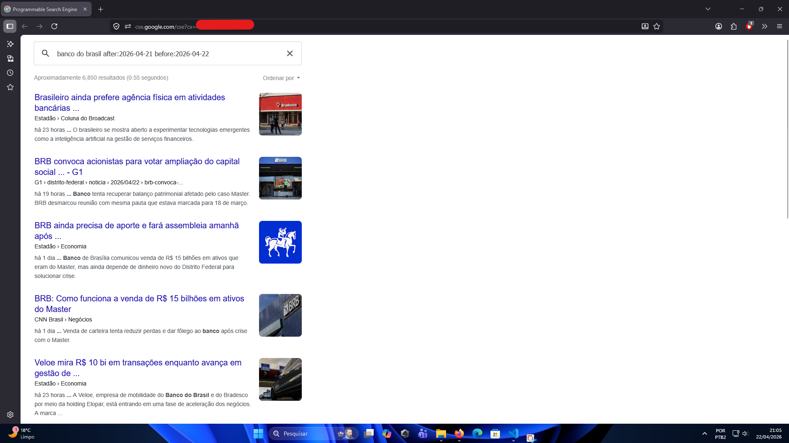

## Trabalho de Conclusão de Curso

### Índice

[1. Introdução](#1-introdução)
[2. Desenvolvimento](#2-desenvolvimento)
[3. Conclusão](#3-conclusão)

### 1. Introdução

### 2. Desenvolvimento

#### 2.1. Limitações técnicas

Para manter o projeto sem custos, optou-se pela coleta manual das notícias envolvendo a empresa.

#### 2.2. Dados utilizados

Para pesquisas envolvendo diretamenta a empresa ou pesquisas gerais:

- [G1](https://g1.globo.com/)
- [UOL](https://noticias.uol.com.br/)
- [CNN Brasil](https://www.cnnbrasil.com.br/)
- [Folha de S. Paulo](https://www.folha.uol.com.br/)
- [Estadão](https://www.estadao.com.br/)
- [Metrópoles](https://www.metropoles.com/)

#### 2.3. Metodologia

**Escopo do Projeto**: Período de 1 ano (jan-dez 2025); Ativos: BBSA3 (Banco do Brasil) + Concorrentes (ITUB4, BBDC4, SANB11); Fontes de notícias: G1, UOL, CNN Brasil, Folha de S. Paulo, Estadão, Metrópoles.

**Buscador escolhido**: Google

**Motivo**: Maior market share no mercado de buscadores de internet no Brasil (maior que 90%)

**a. Coleta Automatizada de Notícias**

Criação de [Mecanismo de Pesquisa do Google](https://developers.google.com/custom-search/docs/tutorial/creatingcse?hl=pt-br)

Serve basicamenta para gerar um buscador do Google para funcionar em outras ferramentas da empresa voltadas ao desenvolvimento de sistemas.

Ao criar um Mecanismo de Pesquisa, um código HTML contendo um script como este é gerado:

```html
<script async src="https://cse.google.com/cse.js?cx=<ID_MECANISMO_PESQUISA_PROGRAMAVEL>">
</script>
<div class="gcse-search"></div>
```

Apesar deste script não ser utilizado no projeto, já pode-se verificar o resultado da pesquisa em funcionamento ao abrir a tela do Custom Search Engine:



O que será de fato usado é o ID de Mecanismo de Pesquisa Programável, parâmetro necessário junto a uma chave de API para utilização em requisições via API Rest da Google.

Exemplo para retornar resultados de 1º de janeiro a 1º de fevereiro de 2010 (inclusivo):

```bash
GET https://www.google.com/cse?cx=12345:example&q=oil+spill&sort=date:r:20100101:20100201 
```

Usando :before diretamente na query possui comportamento não inclusivo.

**b. Pipeline de Dados**

Coleta → Armazenamento (CSV/SQLite) → Pré-processamento → Engenharia de Features → Modelagem → Validação com métricas (RMSE, Acurácia, Teste de Granger).

**c. Frequência de Coleta**: Diária, com timestamp registrado para cada notícia e preço de ação, permitindo análise de lags temporais (T+0, T+1, T+2).

#### 2.4. Tratamento e Engenharia de Features

**a. Features de Ações (BBSA3 e Concorrentes)**

- Variação percentual diária: % mudança de fechamento
- Volatilidade: Desvio padrão móvel de 20 dias
- Volume de negociação: Normalizado por média móvel
- Correlação com concorrentes: Correlação móvel de 10 dias entre BBSA3 e cada banco
- Detecção de anomalias: Movimentos >2σ em relação à média

**b. Features de Notícias (Processamento de Linguagem Natural)**

- Análise de sentimento: Classificação em Positivo (+1), Neutro (0), Negativo (-1) usando NLP; agregação diária
- Frequência de notícias: Contagem de notícias por dia relacionadas a BBSA3
- Menção de concorrentes: Variável binária indicando se notícia menciona Itaú, Bradesco ou Santander
- TF-IDF: Redução dimensional de termos-chave para ~20 componentes principais
- Entity Recognition: Contagem de entidades nomeadas por categoria (banco, governo, commodity) por dia

**c. Features de Validação Cruzada (Análise de Concorrentes)**

- Co-movimento de sentimento: Proporção de dias com sentimento concordante entre BBSA3 e concorrentes
- Variação sincronizada: Binária; 1 se BBSA3 e concorrentes variaram >1% no mesmo sentido
- Lag temporal: Impacto de notícia publicada em T nos dias T+0, T+1, T+2

#### 2.5. Tratamento de Confundidores e Contexto Macroeconômico

**a. Variáveis de Controle**

Para validar causalidade (não apenas correlação), incluir:

- Taxa básica de juros (Selic): Coleta diária. Afeta margem de lucro de bancos e custo do crédito rural.
- Cotação USD/BRL: Coleta diária. Impacta empresas exportadoras e seus financiadores.
- Índices de Commodities: Preços diários de soja, boi gordo, milho (principais no portfólio de crédito rural do BB).
- Índice Bovespa (IBOV): Variação diária para capturar movimentos sistemáticos do mercado.

**b. Teste de Causalidade de Granger**

Antes de modelagem, validar se sentimento causa (não apenas correlaciona com) variações de preço usando teste de Granger com p-value < 0.05 para rejeitar H0 (não há causalidade).

**c. Justificativa Científica (SCI_BOT_2.md)**

O Banco do Brasil é principal financiador do agronegócio. Portanto: (1) notícias sobre políticas agrícolas impactam BB via demanda de crédito; (2) preços de commodities influenciam inadimplência de devedores rurais; (3) variações de Selic modificam estrutura de lucro independente de notícias. O teste de Granger valida se sentimento causa variações além desses confundidores.

#### 2.6. Ideias para a criação de modelos

**a. Abordagem Não Supervisionada**

**1. Clustering Temporal (K-means / DBSCAN)**

- Objetivo: Agrupar dias com padrões similares de variação de preço + características de notícias
- Features: Sentimento diário, frequência de notícias, volatilidade, volume
- Métrica de validação: Silhueta, Inércia, Davies-Bouldin Index
- Interpretação: Cada cluster representa um "regime de mercado" (dias com alto sentimento negativo + volatilidade alta = cluster de incerteza)

**2. Análise de Componentes Principais (PCA)**

- Objetivo: Reduzir dimensionalidade de ~50+ features para ~10-15 componentes principais
- Razão: Visualizar padrões latentes entre notícias e movimentos de preço
- Output: Variância explicada e scatter plots (PC1 vs. PC2) coloridos por cluster

**3. Análise de Co-Movimento**

- Objetivo: Identificar dias em que BBSA3 e concorrentes (ITUB4, BBDC4, SANB11) movem-se em padrões similares
- Método: Calcular correlação móvel (janela 10 dias) entre retornos
- Aplicação: Validar se notícias sobre concorrentes impactam BBSA3 no mesmo sentido (spillover de sentimento)

---

**b. Abordagem Supervisionada**

**1. Regressão (Prever % Variação Diária)**

- Target: Variacao_Pct_BBSA3 (variável contínua)
- Features: Sentimento, frequência de notícias, TF-IDF (20 componentes), lags de preço (t-1, t-2, t-3), variação de concorrentes, Selic, USD/BRL, commodities agrícolas
- Modelos propostos: Regressão Linear (baseline), Ridge/Lasso, Random Forest, XGBoost, LSTM
- Métrica: RMSE (Root Mean Squared Error)
- Validação: Walk-forward validation (treinar até dia T, prever T+1)

**2. Classificação (Prever Direção/Magnitude)**

- Target: Categorizada em 3 classes:
  - Baixa: Variação < -2%
  - Normal: Variação entre -2% e +2%
  - Alta: Variação > +2%
  
  (Alternativa: Binária - Classe 0 = Baixa/Normal, Classe 1 = Alta)

- Features: Idem regressão
- Modelos propostos: SVM (kernel RBF), Gradient Boosting (LightGBM, CatBoost), LSTM com camada de classificação
- Métricas: Acurácia, Precision, Recall, F1-Score
- Validação: Walk-forward com estratificação (manter proporção de classes)

---

**c. Abordagem Híbrida com Validação Causal**

**1. Feature Engineering Baseado em Clustering**

- Usar clusters da abordagem não supervisionada como feature categórica em modelos supervisionados
- Criar variável Regime_Mercado (1=estável, 2=volátil, 3=incerteza) e incluir em regressão/classificação
- Intuição: Notícias têm impactos diferentes em regimes distintos

**2. Teste de Causalidade de Granger**

- Hipótese: Sentimento de notícias causa (Granger-causa) variações de preço?
- Implementação: Comparar modelos com/sem lag de sentimento; p-value < 0.05 rejeita H0 (não há causalidade)
- Implicação científica: Há argumento de que notícias causam (não apenas correlacionam com) mudanças de preço

**3. Validação Cruzada Robusta**

- K-Fold Estratificado: Dividir dados em K folds mantendo proporção de clusters e classes
- Walk-Forward Validation: Adicional; treinar jan-set, validar out, treinar jan-nov, validar dez
- Objetivo: Evitar data leakage e validar generalização temporal

**4. Interpretabilidade com SHAP/LIME**

- SHAP: Decompor contribuição de cada feature para cada predição
- LIME: Explicações locais para predições anômalas
- Output: Gráficos de importância global e plots de força

**5. Comparação de Modelos**

Avaliar RMSE (regressão) e Acurácia (classificação) de todos os modelos; teste de Granger como validação causal adicional.

### 3. Conclusão