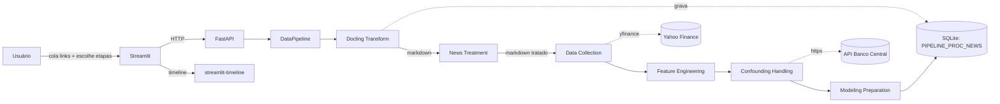

# Pipeline de Análise de Notícias e Ações (BBAS3)

Projeto de Conclusão de Curso (TCC) que mede o **impacto de notícias sobre o preço
da ação BBAS3** (Banco do Brasil) e seus concorrentes. A coleta de notícias é
**manual**: o usuário cola os links das matérias no frontend e a pipeline converte o
conteúdo em Markdown (via [Docling](https://github.com/DS4SD/docling)) antes de
processá-lo.

A implementação segue **Arquitetura Hexagonal** (ports & adapters) e
**Object Calisthenics**, com backend em **FastAPI** e frontend em **Streamlit**.
Consulte o [CHANGELOG.md](CHANGELOG.md) para o histórico de iterações.

### Novidades da Iteração 4

- **Templates Docling corretos** — coluna "original" exibe saída bruta do Docling (sem
  frontmatter); editor exibe o formato tratado com frontmatter. Data no padrão DD-MM-AAAA.
- **Auto-tratamento via LLM reconectado** — checkbox visível quando a etapa de tratamento
  está ativa; `use_llm_treatment` e `treatment_model_path` propagados corretamente ao backend.
- **Breakpoint de conformidade** — se ≥ 1 notícia permanecer não tratada após a etapa de
  tratamento, a pipeline pára com status `BLOCKED`; o frontend exibe as URLs pendentes e
  oferece duas saídas: tratar via UI ou descartar os pendentes e avançar.
- **Sentimento ponta a ponta** — `DataCollectionStage` cria entidades `News` com
  `sentiment_score` populado via `SentimentAnalyzerAdapter` (BERT multilingual). Features
  de sentimento agregadas diariamente pelo `FeatureEngineeringService`.
- **Documentação técnica** — `docs/PIPELINE.md` com diagrama Mermaid, arquitetura hexagonal,
  contratos de dados, fundamentação de features, Granger e walk-forward.
- **Testes atualizados** — `test_news_treatment_stage.py` cobre breakpoint, descarte,
  reutilização, LLM e filtros.

---

## 1. Arquitetura

- **Backend (FastAPI)** — orquestra a pipeline em 6 etapas, cada uma habilitável
  individualmente (feature toggle) e dividida em subetapas tagueadas. Inclui uma etapa
  de **tratamento de notícias** (manual ou via **LLM** em ports & adapters) e enum
  `VramTier` para categorização automática de modelos por memória gráfica.
- **Frontend (Streamlit)** — coleta manual de links (`streamlit-tags`), seleção de
  etapas por **checkbox** (com mapa de dependências entre etapas), **tema claro e
  escuro** com paleta configurável, página de **tratamento de notícias** (editor de
  código sempre visível, com template, ou via **LLM** com status no próprio selectbox),
  progresso aninhado (`stqdm`) e linha do tempo de notícias negativas
  (`streamlit-timeline`).
- **Persistência (SQLite)** — features, resultados de validação/Granger, controle de
  execução por UUID (`PIPELINE_PROC_ID`), processamento de notícias (`PIPELINE_PROC_NEWS`)
  e documentos tratados (`PIPELINE_TREATED_NEWS`).
- **LLM (ports & adapters)** — `LlmPort` com adapter **local** (HuggingFace Transformers,
  download sob demanda por VRAM) ou **API** (Pydantic AI multiprovider), selecionável por
  configuração.



---

## 2. Backend

Estrutura de `backend/`:

```
backend/
├── app/                      # camada de aplicação (FastAPI)
│   ├── api/routes/           # rotas (pipeline, health)
│   ├── api/schemas/          # DTOs Pydantic de request/response
│   └── core/                 # config, logger, exceptions
└── src/                      # núcleo (Arquitetura Hexagonal)
    ├── ports/                # interfaces (DataSourcePort, StoragePort, ...)
    ├── adapters/             # implementações (yfinance, BCB, SQLite, Docling)
    ├── domain/               # models, services, value objects
    └── pipeline/             # orquestrador + estágios
```

### Etapas da pipeline

| Ordem | `stage_name`            | Subetapas (em ordem)                                                        |
|-------|-------------------------|-----------------------------------------------------------------------------|
| 0     | `docling_transform`     | `validar_links` → `converter_markdown` → `registrar_proc_news`              |
| 1     | `news_treatment`        | `selecionar_registros` → `tratar_llm` → `persistir_tratados`                |
| 2     | `data_collection`       | `coletar_precos` → `consolidar_noticias`                                    |
| 3     | `feature_engineering`   | `features_acoes` → `features_noticias` → `features_concorrentes`            |
| 4     | `confounding_handling`  | `coletar_selic` → `coletar_dolar` → `coletar_commodities` → `teste_granger` |
| 5     | `modeling_preparation`  | `dataset_nao_supervisionado` → `dataset_supervisionado` → `walk_forward`    |

Cada etapa habilitada executa; cada etapa desabilitada retorna
`PipelineStageResult(status="SKIPPED")`. Cada subetapa emite uma `SubStageTag`
(`stage_name`, `substage_name`, `order`, `total`) consumida pelo `stqdm` no frontend.

- **Selic e dólar**: recuperados em tempo real da **API do Banco Central** (SGS 11 e
  PTAX) via `BcbApiAdapter`/`httpx`. Para períodos **≥ 1 ano**, o método
  `DateRange.split(max_days=365)` divide o intervalo em janelas consecutivas e o
  adapter itera cada janela de-duplicando por data — sem limite de período.
- **Datas**: lidas exclusivamente do `.env` (`Config.date_range()`), nunca de
  literais no código; a data final nunca ultrapassa `date.today()` (validação no frontend).

### Endpoints da API (`/api`)

| Método | Rota                       | Descrição                                                   |
|--------|----------------------------|-------------------------------------------------------------|
| POST   | `/pipeline/execute`        | Executa a pipeline (recebe `enabled_stages`, `news_links`, `use_llm_treatment`). |
| GET    | `/pipeline/proc_news`      | Consulta `PIPELINE_PROC_NEWS` por URL (de-duplicação).      |
| POST   | `/pipeline/convert_link`   | Converte um link em Markdown sob demanda (UI de tratamento). |
| POST   | `/pipeline/treat_news`     | Trata um Markdown via LLM (local/API).                      |
| POST   | `/pipeline/treated_news`   | Persiste um documento tratado (frontmatter + conteúdo).     |
| GET    | `/pipeline/treated_news`   | Consulta um documento tratado por URL.                      |
| GET    | `/pipeline/llm_models`     | Catálogo de modelos locais + status em disco.               |
| POST   | `/pipeline/download_model` | Baixa o modelo selecionado sob demanda (`llm-models/`).     |
| GET    | `/pipeline/status`         | Status de um job (legado).                                  |
| POST   | `/pipeline/resume`         | Retoma a partir de checkpoint.                              |
| GET    | `/health`                  | Health check do backend.                                    |
| GET    | `/health/db`               | Health check do banco (status + motivo do erro).           |

A resposta de `/pipeline/execute` lista o status de **cada** etapa
(`SUCCESS`/`SKIPPED`/`FAILED`), permitindo retentativa por etapa no frontend.

---

## 3. Frontend

Navegação via `st.navigation`/`st.Page` (arquivos sem prefixo numérico; o número aparece
só no rótulo do sidebar). Cada página traz um **bloco de contexto de negócio** em PT-BR e
respeita o **modo escuro** alternável no sidebar.

1. **Upload de Dados** — input em lote dos links (`streamlit-tags`) + de-duplicação
   contra `PIPELINE_PROC_NEWS`; checkbox para **Google CSE** (exibe campo de ID
   condicionalmente); aba CSV com tabela de colunas esperadas e aviso de descarte.
2. **Executar Pipeline** — seleção de etapas por **checkbox** com mapa de dependências
   (etapas obrigatórias fixas; opcionais desabilitadas enquanto pré-requisito estiver
   desmarcado); progresso aninhado com `stqdm`; **UUID da execução** exibido ao final;
   **retentativa** por etapa em falha. Configuração de LLM fica exclusivamente na tela
   de Tratamento.
3. **Tratamento de Notícias** — editor `streamlit-code-editor` **sempre visível** (com
   template de frontmatter quando nenhuma notícia foi convertida); trata manualmente ou
   via **LLM** (selectbox com status integrado ao label: `Nome (✅ pronto)`); validação
   lado a lado (original × tratado) não-bloqueante; aviso de conformidade de template.
4. **Visualizar Features** / **Validação** / **Análise Exploratória**.
7. **Timeline BBAS3** — `streamlit-timeline` com as notícias de sentimento negativo
   coincidentes com queda de BBAS3.

**Tema**: paleta configurável (7 papéis de cor) em `frontend/components/theme.py`, com
instâncias separadas `_LIGHT` e `_DARK`. Ambos os modos estão funcionais; o toggle
persiste entre páginas via `st.session_state`.

**Restrições de data**: a data final (aba Ações e sidebar) nunca ultrapassa `date.today()`;
a data inicial do sidebar não pode ser anterior à data inicial da aba Ações — violações
são corrigidas automaticamente com `st.warning`.

Bibliotecas: `stqdm` (progresso), `streamlit-tags` (links), `streamlit-code-editor`
(editor de tratamento), `streamlit-timeline` (linha do tempo).

---

## 4. Modelos da base de dados

| Tabela                  | Campos principais                                                          |
|-------------------------|----------------------------------------------------------------------------|
| `PIPELINE_PROC_ID`      | `PROC_ID` (PK), `PROC_TS_START`, `PROC_TS_END` (NULL enquanto roda)         |
| `PIPELINE_PROC_NEWS`    | `URL` (PK), `PROC_ID`, `PROC_TS`, `NM_SITE`, `PROC_SUCCESS`                 |
| `PIPELINE_TREATED_NEWS` | `URL` (PK), `PROC_ID`, `TITLE`, `SUBTITLE`, `NEWS_DATE`, `CONTENT`          |
| `features_<dataset>`    | colunas dinâmicas das features calculadas (uma por dataset)                |
| `validation_results`    | `id` (PK), `data` (JSON), `created_at`                                     |
| `granger_results`       | `id` (PK), `data` (JSON), `created_at`                                     |

Cada execução grava uma linha em `PIPELINE_PROC_ID` (início; `PROC_TS_END` é carimbado ao
final, em sucesso ou falha) e propaga o `PROC_ID` para `PIPELINE_PROC_NEWS` e
`PIPELINE_TREATED_NEWS`. Bancos antigos são migrados de forma **idempotente** na
inicialização (`TS_PROC` → `PROC_TS`, adição de `PROC_ID`), sem perda de dados.

`NM_SITE` é derivado do domínio do link (ex.: `g1.globo.com` → `G1`) entre os
portais G1, UOL, CNN Brasil, Folha, Estadão e Metrópoles.

---

## 5. Variáveis de ambiente

Copie `.env.example` para `.env` e ajuste os valores. Referência consolidada:

| Variável             | Exemplo                                  |
|----------------------|------------------------------------------|
| `DATE_START`         | `2025-01-01`                             |
| `DATE_END`           | `2025-12-31`                             |
| `DATA_INICIAL_SELIC` | `01/01/2025`  (Selic: `DD/MM/YYYY`)      |
| `DATA_FINAL_SELIC`   | `31/12/2025`                             |
| `DATA_INICIAL_DOLAR` | `01-01-2025`  (PTAX: `MM-DD-YYYY`)       |
| `DATA_FINAL_DOLAR`   | `12-31-2025`                             |
| `API_BCB_SELIC`      | URL SGS 11 (ver `.env.example`)          |
| `API_BCB_DOLAR`      | URL PTAX (ver `.env.example`)            |
| `DATABASE_URL`       | local: default relativo ao repo · Docker: `sqlite:////app/data/pipeline.db` |
| `YFINANCE_TICKERS`   | `BBAS3.SA,ITUB4.SA,BBDC4.SA,SANB11.SA`   |
| `LLM_BACKEND`        | `api` \| `local`                         |
| `LLM_API_PROVIDER`   | `anthropic` (Pydantic AI)                |
| `LLM_API_MODEL`      | `claude-sonnet-4-6`                      |
| `LLM_MODELS_DIR`     | `llm-models`                             |
| `LLM_MODELS`         | JSON do catálogo por VRAM (ver `.env.example`) |

---

## 6. Instruções de execução

### Docker (recomendado)

```bash
cp .env.example .env   # ajuste os valores
docker-compose up --build
```

- Backend: http://localhost:8000 (docs em `/docs`)
- Frontend: http://localhost:8501

### Execução local (sem Docker)

O Docker é **opcional**: o `DATABASE_URL` tem default em um SQLite portátil
(`<repo>/data/pipeline.db`), então backend e frontend sobem standalone, sem o serviço
`db` do `docker-compose`. Troque `DATABASE_URL` no `.env` para apontar a outro arquivo/base.

```bash
cp .env.example .env   # ajuste os valores (datas, LLM, etc.)

# Backend
pip install -r backend/requirements.txt
uvicorn app.main:app --app-dir backend --reload --port 8000

# Frontend (outro terminal)
pip install -r frontend/requirements.txt
streamlit run frontend/app.py
```

Clique em **🔄 Verificar Status** no sidebar para conferir backend **e** banco; um erro de
banco exibe o motivo e some na nova tentativa.

### Configuração de LLM (tratamento de notícias)

A etapa de tratamento limpa o Markdown e insere um frontmatter (`title`, `subtitle`,
`url`, `date`). O provedor é selecionável por configuração (`LLM_BACKEND`):

- **API** (`LLM_BACKEND=api`) — Pydantic AI multiprovider; defina `LLM_API_PROVIDER`
  (ex.: `anthropic`) e `LLM_API_MODEL` (ex.: `claude-sonnet-4-6`) e a credencial do
  provedor (ex.: `ANTHROPIC_API_KEY`).
- **Local** (`LLM_BACKEND=local`) — HuggingFace Transformers. O catálogo `LLM_MODELS`
  (JSON, sem nomes hardcoded) lista nome, VRAM, aplicação e caminho de cada modelo. O
  download é **sob demanda** (somente após iniciar a execução e só do modelo selecionado),
  para a pasta `llm-models/` (ignorada por git/docker); modelos já presentes não são
  rebaixados.

### Testes

```bash
pip install pytest
pytest backend/tests -v
```

### Gerenciamento de dependências (uv)

As dependências são gerenciadas com [uv](https://docs.astral.sh/uv/):

- `backend/requirements.in` e `frontend/requirements.in` — pins de **alto nível** (editáveis).
- `backend/requirements.txt` e `frontend/requirements.txt` — **locks gerados** (não editar à mão).

Para alterar uma dependência: edite o `.in` correspondente e regenere os locks:

```bash
bash scripts/lock.sh   # resolve num container Linux e atualiza os *.txt
docker compose build   # reconstrói com o lock novo
```

> O `lock.sh` resolve as versões para a plataforma alvo (x86_64 Linux) com
> hashes, então o build é reprodutível independente do SO do host.

---

## 7. Fluxo de uso

1. Cole os links das notícias na página **Upload de Dados** (de-duplicação automática).
   - Opcionalmente configure um **Google CSE** (`cx`) para buscar links diretamente na
     interface — o embed é renderizado no browser ao informar o ID.
2. Em **Tratamento de Notícias**, limpe o conteúdo de cada link — manualmente ou via LLM —
   e valide o resultado lado a lado (original × tratado). Use **✅ Aceitar** para salvar
   e avançar ou **↩️ Descartar** para restaurar o texto pré-edição.
3. Em **Executar Pipeline**, selecione as etapas por checkbox e inicie a execução.
4. Acompanhe o progresso aninhado (`stqdm`) e retente etapas que falharem.
5. Visualize as features e a **timeline** das notícias com impacto negativo em BBAS3.
