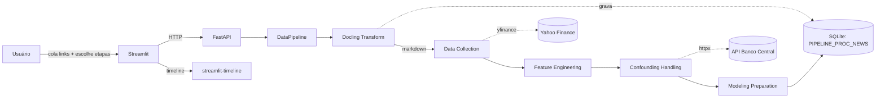

# Pipeline de Análise de Notícias e Ações (BBAS3)

Projeto de Conclusão de Curso (TCC) que mede o **impacto de notícias sobre o preço
da ação BBAS3** (Banco do Brasil) e seus concorrentes. A coleta de notícias é
**manual**: o usuário cola os links das matérias no frontend e a pipeline converte o
conteúdo em Markdown (via [Docling](https://github.com/DS4SD/docling)) antes de
processá-lo.

A implementação segue **Arquitetura Hexagonal** (ports & adapters) e
**Object Calisthenics**, com backend em **FastAPI** e frontend em **Streamlit**.

---

## 1. Arquitetura

- **Backend (FastAPI)** — orquestra a pipeline em 5 etapas, cada uma habilitável
  individualmente (feature toggle) e dividida em subetapas tagueadas.
- **Frontend (Streamlit)** — coleta manual de links (`streamlit-tags`), seleção de
  etapas (`multiselect`), progresso aninhado (`stqdm`) e linha do tempo de notícias
  negativas (`streamlit-timeline`).
- **Persistência (SQLite)** — features, resultados de validação/Granger e a tabela
  de controle de processamento de notícias `PIPELINE_PROC_NEWS`.



---

## 2. Backend

Estrutura de `backend/`:

```
backend/
├── app/                      # camada de aplicação (FastAPI)
│   ├── api/routes/           # rotas (pipeline, health)
│   ├── api/schemas/          # DTOs Pydantic de request/response
│   └── core/                 # config, logger, exceptions
└── src/                      # núcleo (Arquitetura Hexagonal)
    ├── ports/                # interfaces (DataSourcePort, StoragePort, ...)
    ├── adapters/             # implementações (yfinance, BCB, SQLite, Docling)
    ├── domain/               # models, services, value objects
    └── pipeline/             # orquestrador + estágios
```

### Etapas da pipeline

| Ordem | `stage_name`            | Subetapas (em ordem)                                                        |
|-------|-------------------------|-----------------------------------------------------------------------------|
| 0     | `docling_transform`     | `validar_links` → `converter_markdown` → `registrar_proc_news`              |
| 1     | `data_collection`       | `coletar_precos` → `consolidar_noticias`                                    |
| 2     | `feature_engineering`   | `features_acoes` → `features_noticias` → `features_concorrentes`            |
| 3     | `confounding_handling`  | `coletar_selic` → `coletar_dolar` → `coletar_commodities` → `teste_granger` |
| 4     | `modeling_preparation`  | `dataset_nao_supervisionado` → `dataset_supervisionado` → `walk_forward`    |

Cada etapa habilitada executa; cada etapa desabilitada retorna
`PipelineStageResult(status="SKIPPED")`. Cada subetapa emite uma `SubStageTag`
(`stage_name`, `substage_name`, `order`, `total`) consumida pelo `stqdm` no frontend.

- **Selic e dólar**: recuperados em tempo real da **API do Banco Central** (SGS 11 e
  PTAX) via `BcbApiAdapter`/`httpx`, parametrizados por variáveis de ambiente — sem
  mocks.
- **Datas**: lidas exclusivamente do `.env` (`Config.date_range()`), nunca de
  literais no código.

### Endpoints da API (`/api`)

| Método | Rota                       | Descrição                                                   |
|--------|----------------------------|-------------------------------------------------------------|
| POST   | `/pipeline/execute`        | Executa a pipeline (recebe `enabled_stages`, `news_links`). |
| GET    | `/pipeline/proc_news`      | Consulta `PIPELINE_PROC_NEWS` por URL (de-duplicação).      |
| GET    | `/pipeline/status`         | Status de um job (legado).                                  |
| POST   | `/pipeline/resume`         | Retoma a partir de checkpoint.                              |
| GET    | `/health`                  | Health check.                                               |

A resposta de `/pipeline/execute` lista o status de **cada** etapa
(`SUCCESS`/`SKIPPED`/`FAILED`), permitindo retentativa por etapa no frontend.

---

## 3. Frontend

Páginas Streamlit (`frontend/pages/`):

1. **Upload de Dados** — input em lote dos links (`streamlit-tags`) + de-duplicação
   contra `PIPELINE_PROC_NEWS`.
2. **Executar Pipeline** — `multiselect` das etapas (feature toggle), progresso
   aninhado com `stqdm` (etapa → subetapa, com razão `ordem/total`) e botão de
   **retentativa** por etapa em falha.
3. **Visualizar Features** / **Validação** / **Análise Exploratória**.
6. **Timeline BBAS3** — `streamlit-timeline` com as notícias de sentimento negativo
   coincidentes com queda de BBAS3.

Bibliotecas: `stqdm` (progresso), `streamlit-tags` (links), `streamlit-timeline`
(linha do tempo).

---

## 4. Modelos da base de dados

| Tabela                 | Campos principais                                                        |
|------------------------|--------------------------------------------------------------------------|
| `PIPELINE_PROC_NEWS`   | `URL` (PK), `TS_PROC` (timestamp), `NM_SITE` (texto), `PROC_SUCCESS` (bool) |
| `features_<dataset>`   | colunas dinâmicas das features calculadas (uma por dataset)              |
| `validation_results`   | `id` (PK), `data` (JSON), `created_at`                                   |
| `granger_results`      | `id` (PK), `data` (JSON), `created_at`                                   |

`NM_SITE` é derivado do domínio do link (ex.: `g1.globo.com` → `G1`) entre os
portais G1, UOL, CNN Brasil, Folha, Estadão e Metrópoles.

---

## 5. Variáveis de ambiente

Copie `.env.example` para `.env` e ajuste os valores. Referência consolidada:

| Variável             | Exemplo                                  |
|----------------------|------------------------------------------|
| `DATE_START`         | `2025-01-01`                             |
| `DATE_END`           | `2025-12-31`                             |
| `DATA_INICIAL_SELIC` | `01/01/2025`  (Selic: `DD/MM/YYYY`)      |
| `DATA_FINAL_SELIC`   | `31/12/2025`                             |
| `DATA_INICIAL_DOLAR` | `01-01-2025`  (PTAX: `MM-DD-YYYY`)       |
| `DATA_FINAL_DOLAR`   | `12-31-2025`                             |
| `API_BCB_SELIC`      | URL SGS 11 (ver `.env.example`)          |
| `API_BCB_DOLAR`      | URL PTAX (ver `.env.example`)            |
| `DATABASE_URL`       | local: default relativo ao repo · Docker: `sqlite:////app/data/pipeline.db` |
| `YFINANCE_TICKERS`   | `BBAS3.SA,ITUB4.SA,BBDC4.SA,SANB11.SA`   |

---

## 6. Instruções de execução

### Docker (recomendado)

```bash
cp .env.example .env   # ajuste os valores
docker-compose up --build
```

- Backend: http://localhost:8000 (docs em `/docs`)
- Frontend: http://localhost:8501

### Execução local

```bash
# Backend
pip install -r backend/requirements.txt
uvicorn app.main:app --app-dir backend --reload --port 8000

# Frontend (outro terminal)
pip install -r frontend/requirements.txt
streamlit run frontend/app.py
```

### Testes

```bash
pip install pytest
pytest backend/tests -v
```

### Gerenciamento de dependências (uv)

As dependências são gerenciadas com [uv](https://docs.astral.sh/uv/):

- `backend/requirements.in` e `frontend/requirements.in` — pins de **alto nível** (editáveis).
- `backend/requirements.txt` e `frontend/requirements.txt` — **locks gerados** (não editar à mão).

Para alterar uma dependência: edite o `.in` correspondente e regenere os locks:

```bash
bash scripts/lock.sh   # resolve num container Linux e atualiza os *.txt
docker compose build   # reconstrói com o lock novo
```

> O `lock.sh` resolve as versões para a plataforma alvo (x86_64 Linux) com
> hashes, então o build é reprodutível independente do SO do host.

---

## 7. Fluxo de uso

1. Cole os links das notícias na página **Upload de Dados** (de-duplicação automática).
2. Em **Executar Pipeline**, selecione as etapas desejadas e inicie a execução.
3. Acompanhe o progresso aninhado (`stqdm`) e retente etapas que falharem.
4. Visualize as features e a **timeline** das notícias com impacto negativo em BBAS3.
