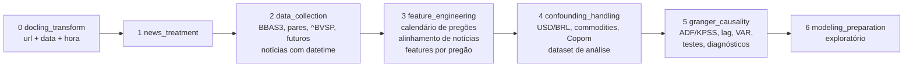

# Especificação — Alinhar a pipeline ao desenho de causalidade de Granger do TCC

> **Status:** proposta para implementação · **Data:** 14/11/2026
> **Origem:** versão revisada de `researches/Entrega Final TCC.docx` (seções 2.1 a 2.5 e Tabela 1), com base em `researches/revisao-granger-entrega-final.md`.
> **Escopo:** este documento descreve **o que** mudar no código e **como verificar**. Ele não altera código.

---

## Sumário

1. [Objetivo](#1-objetivo)
2. [Matriz de rastreabilidade (texto → código)](#2-matriz-de-rastreabilidade-texto--código)
3. [Visão geral da pipeline após a mudança](#3-visão-geral-da-pipeline-após-a-mudança)
4. [Requisitos funcionais](#4-requisitos-funcionais)
5. [Contrato do dataset de análise](#5-contrato-do-dataset-de-análise)
6. [Configuração (.env)](#6-configuração-env)
7. [Plano de testes](#7-plano-de-testes)
8. [Fases e prioridade](#8-fases-e-prioridade)
9. [Critérios de aceite ligados ao texto](#9-critérios-de-aceite-ligados-ao-texto)
10. [Fora de escopo, riscos e pontos a confirmar](#10-fora-de-escopo-riscos-e-pontos-a-confirmar)

---

## 1. Objetivo

O texto do TCC agora diz que a pipeline:

- constrói **séries diárias alinhadas aos pregões da B3**: notícias de fim de semana, feriado ou publicadas depois do fechamento vão para o pregão seguinte;
- usa o **retorno logarítmico** da BBAS3 como variável dependente, com o retorno anormal e |rₜ| como robustez;
- usa como variáveis de notícias o **sentimento líquido** Sₜ, o **volume** Nₜ e o **indicador de presença** Dₜ;
- mantém **controles fixos**, sem filtro por p-valor: Ibovespa, concorrentes (ITUB4, BBDC4, SANB11), variação do USD/BRL, commodities agrícolas e indicador de decisões do Copom;
- aplica o **teste de Granger em um VAR**:
  - ADF/KPSS;
  - defasagem escolhida por AIC/BIC (limite de 10 pregões);
  - Toda-Yamamoto se houver série integrada;
  - testes nos dois sentidos;
  - diagnóstico dos resíduos e erros robustos;
  - correção de Holm/BH;
  - causalidade instantânea;
- interpreta o resultado como **causalidade preditiva** (precedência temporal), nunca como causa estrutural.

Hoje a pipeline **não faz** quase nada disso. Os principais pontos:

| Problema atual | Onde |
|---|---|
| O "teste de Granger" calcula uma correlação contemporânea, e o p-valor é `1/(1+|t|)`, que não é a distribuição F | [`confounding_handler_service.py:220-241`](../backend/src/domain/services/confounding_handler_service.py#L220-L241) |
| A etapa devolve `granger_test_results: []` (TODO) | [`confounding_handling_stage.py:89-96`](../backend/src/pipeline/stages/confounding_handling_stage.py#L89-L96) |
| Os preços de commodities são `np.random.uniform` | [`confounding_handler_service.py:126-134`](../backend/src/domain/services/confounding_handler_service.py#L126-L134) |
| O calendário usa dias corridos (TODO) | [`confounding_handler_service.py:250-257`](../backend/src/domain/services/confounding_handler_service.py#L250-L257) |
| As features de notícias só têm linhas nos dias com notícia, com a média dos scores por **data de publicação** | [`feature_engineering_service.py:69-91`](../backend/src/domain/services/feature_engineering_service.py#L69-L91) |
| O volume é normalizado com mínimo e máximo da amostra inteira (*look-ahead*) | [`feature_engineering_service.py:133-141`](../backend/src/domain/services/feature_engineering_service.py#L133-L141) |
| `calculate_competitor_features` monta um DataFrame com listas de tamanhos diferentes (`tickers` inclui BBAS3, `correlations` não). A exceção é engolida e a etapa devolve `{}` | [`feature_engineering_service.py:93-108`](../backend/src/domain/services/feature_engineering_service.py#L93-L108), [`feature_engineering_stage.py:138-147`](../backend/src/pipeline/stages/feature_engineering_stage.py#L138-L147) |
| Não há horário de publicação, Ibovespa nem indicador do Copom | — |
| `TickerSymbol` exige 5 caracteres ou mais, o que recusa `ZS=F`, `ZC=F` e `LE=F` | [`ticker_symbol.py:25`](../backend/src/domain/value_objects/ticker_symbol.py#L25) |

**Decisões já tomadas:**
- commodities via **contratos futuros no yfinance**;
- horário de publicação informado **no JSON de entrada dos links**.

---

## 2. Matriz de rastreabilidade (texto → código)

| Trecho do TCC (docx) | Afirmação | Requisito |
|---|---|---|
| 2.1, objetivo específico 3 | Validar a classificação de sentimento em amostra rotulada manualmente | RF-15 |
| 2.1, objetivos 4 e 5 | Construir séries diárias alinhadas aos pregões; Granger nos dois sentidos, condicionado a controles | RF-04, RF-06, RF-09 |
| 2.2 | Frequência diária, pregões da B3 de 2025 | RF-04 |
| 2.3, cointegração | Commodities entram como controle | RF-03, RF-08 |
| 2.3, definição de Granger | Teste F entre modelo restrito e irrestrito; defasagem escolhida por critério de informação | RF-09 |
| 2.4, Frequência e calendário | Fim de semana, feriado ou após o fechamento vai para o pregão seguinte | RF-01, RF-02, RF-04 |
| 2.4, Variável dependente | rₜ = ln(Pₜ/Pₜ₋₁) com preço ajustado; retorno anormal rₜ − β̂·r_IBOV,t; \|rₜ\| | RF-03, RF-05, RF-09 |
| 2.4, Variáveis de notícias | Nₜ; Sₜ = (n⁺ₜ − n⁻ₜ)/Nₜ, com Sₜ = 0 se Nₜ = 0; Dₜ; alternativa com contagens separadas | RF-06 |
| 2.4, Variáveis de controle | Ibovespa, ITUB4/BBDC4/SANB11, USD/BRL, commodities; Copom como indicador (não a Selic em nível); entram sem filtro de significância | RF-07, RF-08 |
| 2.4, Modelo e hipóteses | VAR; H₀: γ₁ = … = γₚ = 0; estatística F | RF-09 |
| 2.4, Procedimento (1) a (6) | ADF/KPSS + Toda-Yamamoto; AIC/BIC até 10; F nos 4 sentidos; Portmanteau + heterocedasticidade + robustos; Holm/BH; causalidade instantânea; α = 5% | RF-09 |
| 2.4, Interpretação | "Causalidade preditiva"; não rejeitar ≠ ausência de relação | RF-09 (texto do relatório), RF-12 |
| 2.5, passo 3 | Regra de estrelas → {−1, 0, +1}; registro de data **e horário** | RF-01, RF-02 (a regra já existe em [`sentiment_analyzer_adapter.py:87-97`](../backend/src/adapters/processors/sentiment_analyzer_adapter.py#L87-L97)) |
| 2.5, passo 5, features de ações | Retorno log; volatilidade rolling só para visualização, \|rₜ\| no teste; volume normalizado só com dados passados; 2σ descritivo | RF-05 |
| 2.5, passo 5, features de notícias | Sₜ, Dₜ, Nₜ | RF-06 |
| 2.5, passo 5, concorrentes | Retorno diário dos concorrentes como controle; correlação descritiva | RF-07 |
| 2.5, artefatos e walk-forward | Exploratórios, fora do teste; Granger fora da amostra (opcional) | RF-13 |
| 2.5, passo 6 | VAR com notícias + controles fixos; H₀ de sentimento e de volume; sentidos inversos; p ajustados | RF-09, RF-10 |
| Tabela 1 | Abordagem "teste de Granger em modelo VAR com controles"; critério "teste F nos dois sentidos" | RF-09, RF-12 |

---

## 3. Visão geral da pipeline após a mudança



| # | Etapa (`StageName`) | Subetapas |
|---|---|---|
| 0 | `docling_transform` | `validar_links` → `converter_markdown` → `registrar_proc_news` (sem mudança de nome; propaga `news_time`) |
| 1 | `news_treatment` | sem mudança |
| 2 | `data_collection` | `coletar_precos` → `coletar_indice` → `coletar_commodities` → `consolidar_noticias` |
| 3 | `feature_engineering` | `calendario_pregoes` → `alinhar_noticias` → `features_acoes` → `features_noticias` → `features_concorrentes` |
| 4 | `confounding_handling` | `coletar_dolar` → `indicador_copom` → `montar_dataset` |
| 5 | `granger_causality` **(nova)** | `estacionariedade` → `selecao_defasagens` → `testes_granger` → `diagnosticos` |
| 6 | `modeling_preparation` | sem mudança de nomes |

As commodities passam a ser coletadas em `data_collection`, junto com os demais preços via yfinance, e não mais em `confounding_handling`. A Selic sai do dataset do teste. A coleta via BCB pode continuar existindo para gráficos.

---

## 4. Requisitos funcionais

Convenção: cada requisito traz **arquivos**, **comportamento** e **aceite**. Nomes de colunas e chaves estão em `snake_case`.

### RF-01 — Contrato de entrada com horário de publicação

**Arquivos:**
- [`news_links_by_date.py`](../backend/src/domain/value_objects/news_links_by_date.py)
- [`docling_transform_stage.py`](../backend/src/pipeline/stages/docling_transform_stage.py)
- [`proc_news.py`](../backend/src/domain/models/proc_news.py)
- [`sqlite_storage.py`](../backend/src/adapters/storage/sqlite_storage.py)
- [`frontend/components/news_links.py`](../frontend/components/news_links.py)
- [`frontend/pages/upload_dados.py`](../frontend/pages/upload_dados.py)
- [`news-links-2025.json`](news-links-2025.json)

**Comportamento:**
- Cada item da lista de uma data aceita **dois formatos**, que podem ser misturados:
  ```json
  {
    "news_links": {
      "2025-03-14": [
        "https://g1.globo.com/.../a.ghtml",
        {"url": "https://www.estadao.com.br/.../b/", "time": "18:42"}
      ]
    }
  }
  ```
  - `string`: formato legado; o horário fica desconhecido (`None`).
  - `objeto`: `url` é obrigatório; `time` é opcional, no formato `HH:MM` 24h, horário de Brasília.
- Validação (mensagens em PT-BR, como as atuais):
  - `time` fora do padrão `^\d{2}:\d{2}$` ou inválido (ex.: `25:10`) gera `ValueError` citando a data e a URL;
  - chaves desconhecidas no objeto geram `ValueError`;
  - a regra de "URL em mais de uma data" continua valendo.
- API do value object:
  - `items()` passa a devolver `List[Tuple[str, date, Optional[time]]]`;
  - `to_dict()` serializa cada item como string quando não há horário e como objeto quando há, para manter o formato de ida e volta;
  - novo método `time_of(url) -> Optional[time]`.
- Docling ([`docling_transform_stage.py:84-134`](../backend/src/pipeline/stages/docling_transform_stage.py#L84-L134)): cada entrada de `news_markdowns` ganha a chave `news_time` (`"HH:MM"` ou `None`), ao lado de `news_date`.
- Persistência: `PIPELINE_PROC_NEWS` ganha a coluna `NEWS_TIME TEXT NULL`.
  - Atualizar `_PROC_NEWS_COLUMNS` ([`sqlite_storage.py:14-16`](../backend/src/adapters/storage/sqlite_storage.py#L14-L16)), os `INSERT` e `SELECT` e `ProcNewsRecord`.
  - O padrão atual de "descartar e recriar a tabela desatualizada" ([`sqlite_storage.py:353-365`](../backend/src/adapters/storage/sqlite_storage.py#L353-L365)) resolve a migração.
- Frontend:
  - `parse_json` aceita os dois formatos;
  - na entrada manual por tags, aceitar o atalho `HH:MM url` (horário, espaço, URL);
  - a ajuda da página explica o formato e que o horário é o de Brasília.

**Aceite:**
- Os JSONs atuais continuam válidos, sem mudança nenhuma.
- Um item-objeto com `time` chega até `PIPELINE_PROC_NEWS.NEWS_TIME` e até `News.published_time`.

### RF-02 — Data e hora na entidade `News`

**Arquivos:**
- [`news.py`](../backend/src/domain/models/news.py)
- [`data_collection_stage.py`](../backend/src/pipeline/stages/data_collection_stage.py)

**Comportamento:**
- `News` ganha `published_time: Optional[datetime.time] = None`. O campo `published_date` continua sendo a data, como `datetime` à meia-noite, para não quebrar quem o consome.
- `DataCollectionStage._entry_to_news` lê `entry["news_time"]` e preenche `published_time`.
- A regra de precedência da data (frontmatter vence, com aviso de divergência) não muda. O horário vem **somente** do JSON de entrada.

**Aceite:**
- Teste unitário: uma entrada com `news_time="18:42"` produz `News.published_time == time(18, 42)`.
- Uma entrada sem `news_time` produz `None`.

### RF-03 — Dados de mercado: Ibovespa e futuros de commodities

**Arquivos:**
- [`config.py`](../backend/app/core/config.py)
- [`ticker_symbol.py`](../backend/src/domain/value_objects/ticker_symbol.py)
- [`yfinance_adapter.py`](../backend/src/adapters/data_sources/yfinance_adapter.py)
- [`data_collection_stage.py`](../backend/src/pipeline/stages/data_collection_stage.py)
- [`pipeline.py`](../backend/src/pipeline/pipeline.py) (`_initialize_stages`)

**Comportamento:**
- Novas configurações (ver §6):
  - `MARKET_INDEX_TICKER` (padrão `^BVSP`);
  - `COMMODITY_TICKERS` (padrão `ZS=F,ZC=F,LE=F`: soja e milho na CBOT, boi gordo na CME).
  - `YFINANCE_TICKERS` continua contendo BBAS3 e os concorrentes. A BBAS3 é identificada pela nova configuração `TARGET_TICKER` (padrão `BBAS3.SA`), em vez da string fixa `"BBAS3.SA"` espalhada pelo serviço.
- `TickerSymbol`: trocar a regra "5 caracteres ou mais" por um padrão que aceite `^BVSP`, `ZS=F` e `BBAS3.SA`:
  - regex sugerida: `^\^?[A-Z0-9]{1,10}(\.[A-Z]{1,3}|=F)?$`;
  - manter a exigência de letras maiúsculas.
- `YFinanceAdapter._fetch_history`:
  - o `end` do yfinance é **exclusivo**, então chamar com `end = end_date + 1 dia`;
  - registrar em docstring que `Ticker.history()` devolve o fechamento **ajustado** (`auto_adjust=True` por padrão), que é o preço exigido pelo texto.
- `DataCollectionStage` coleta, nesta ordem e com subetapas próprias:
  - `coletar_precos`: alvo + concorrentes;
  - `coletar_indice`: `MARKET_INDEX_TICKER`;
  - `coletar_commodities`: cada item de `COMMODITY_TICKERS`.
- Saída adicional da etapa: `index_prices: List[StockPrice]` e `commodity_prices: Dict[str, List[StockPrice]]`.
- Falhas de download devolvem uma lista vazia, como hoje, mas **registram um aviso**. Se o **alvo** ou o **índice** vier vazio, a etapa falha (`FAILED`), porque não há teste sem eles. Se commodities ou concorrentes vierem vazios, a etapa só avisa e a variável é removida do modelo.

**Aceite:**
- Teste com um adapter falso confirma que os três grupos são coletados e que `end` recebe +1 dia.
- `TickerSymbol("ZS=F")` é aceito e `TickerSymbol("zs=f")` é recusado.

### RF-04 — Calendário de pregões e alinhamento das notícias

**Arquivos:**
- novo `backend/src/domain/services/session_alignment.py`, com funções puras;
- uso em [`feature_engineering_stage.py`](../backend/src/pipeline/stages/feature_engineering_stage.py).

**Comportamento:**
- **Calendário de pregões** = conjunto ordenado das datas com cotação do `TARGET_TICKER` no período. Essa é a fonte de verdade, porque já exclui fins de semana e feriados da B3 sem precisar de uma tabela de feriados.
- Função `align_news_to_sessions(news, sessions, close_time) -> Dict[date, List[News]]`, onde `d` é a data de publicação e `h` o horário (opcional):

| Situação | Pregão atribuído |
|---|---|
| `d` é pregão e (`h` é `None` ou `h` ≤ `close_time`) | `d` |
| `d` é pregão e `h` > `close_time` | primeiro pregão **depois** de `d` |
| `d` não é pregão (fim de semana ou feriado) | primeiro pregão depois de `d` |
| Não existe pregão posterior dentro do período | notícia descartada, com contagem registrada em log |
| `d` é anterior ao primeiro pregão do período | atribuída ao primeiro pregão |

- `close_time` vem de `MARKET_CLOSE_TIME` (padrão `17:00`). O fechamento do pregão regular da B3 muda com o horário de verão dos EUA (17h ou 18h), por isso o valor é configurável.
- Notícia sem horário publicada em dia de pregão é considerada "durante o pregão". Isso fica registrado como premissa no relatório de Granger (RF-09, campo `warnings`).
- O relatório guarda contagens de auditoria: quantas notícias foram movidas por fim de semana ou feriado, quantas por horário, quantas não tinham horário e quantas foram descartadas.

**Aceite:** testes unitários cobrindo cada linha da tabela (ver §7).

### RF-05 — Features de ações

**Arquivo:** [`feature_engineering_service.py`](../backend/src/domain/services/feature_engineering_service.py)

**Comportamento** (todas as colunas indexadas por pregão):

| Coluna | Fórmula | Uso |
|---|---|---|
| `log_return` | ln(Pₜ / Pₜ₋₁), com P = fechamento ajustado | **Y do teste** |
| `abs_return` | \|`log_return`\| | Y de robustez (magnitude e volatilidade) |
| `daily_return_pct` | (Pₜ/Pₜ₋₁ − 1)·100 | mantida para gráficos e para a modelagem atual |
| `volatility_20d` | desvio-padrão rolling de 20 dias de `log_return` | **só para visualização**; não entra no VAR |
| `volume_normalized` | (vₜ − min₀..ₜ v) / (max₀..ₜ v − min₀..ₜ v), com mínimo e máximo **expansivos** (`expanding()`); 0,5 quando max = min | exploratória; sem *look-ahead* |
| `anomaly_flag` | \|rₜ − μ\| > k·σ, com k = `ANOMALY_STD_THRESHOLD` | descritiva; não entra no VAR |

- Corrigir a fórmula atual do 2σ ([`feature_engineering_service.py:143-152`](../backend/src/domain/services/feature_engineering_service.py#L143-L152)), que hoje calcula `|r| − |μ|` em vez de `|r − μ|`.
- O mesmo cálculo de `log_return` é aplicado ao índice e a cada concorrente e commodity, com uma função utilitária única (`log_returns(prices) -> pd.Series`).

**Aceite:**
- `volume_normalized` no dia t não muda quando se acrescentam dados depois de t (teste de *look-ahead*).
- `log_return` confere com valores calculados à mão.

### RF-06 — Features de notícias por pregão

**Arquivo:** [`feature_engineering_service.py`](../backend/src/domain/services/feature_engineering_service.py), que substitui `calculate_news_features`.

**Comportamento:**
- Entrada: o resultado de RF-04 (notícias já atribuídas a pregões) e a lista completa de pregões.
- Saída: **uma linha para cada pregão**, inclusive os sem notícia:

| Coluna | Definição |
|---|---|
| `n_news` (Nₜ) | número de notícias atribuídas ao pregão |
| `n_pos`, `n_neg`, `n_neu` | contagens por score +1, −1 e 0 |
| `sent_net` (Sₜ) | (`n_pos` − `n_neg`) / `n_news`; **0 quando `n_news` = 0** |
| `has_news` (Dₜ) | 1 se `n_news` > 0, senão 0 |

- Notícias sem `sentiment_score` contam em `n_news`, mas não em `n_pos`, `n_neg` nem `n_neu`. O total delas aparece no relatório.
- A coluna antiga `sentiment_score` (média) deixa de existir. A modelagem passa a usar `sent_net` (RF-13).
- A especificação alternativa do texto ("contagens negativas e positivas como séries separadas") é controlada por `GRANGER_NEWS_SPEC`:
  - `net` (padrão) usa `sent_net` e `n_news`;
  - `split` usa `n_pos` e `n_neg`.

**Aceite:**
- Um período com 5 pregões e notícias em só 2 deles gera 5 linhas.
- `sent_net` e `has_news` ficam corretos nos 5 dias.

### RF-07 — Concorrentes

**Arquivo:** [`feature_engineering_service.py`](../backend/src/domain/services/feature_engineering_service.py)

**Comportamento:**
- Novo controle `ret_peers` = média simples dos `log_return` de ITUB4, BBDC4 e SANB11 em cada pregão.
  - `PEERS_AGGREGATION=mean` é o padrão.
  - `PEERS_AGGREGATION=separate` mantém uma coluna por ticker (`ret_itub4` etc.), para análise de sensibilidade.
  - A média reduz o número de parâmetros do VAR, o que importa com cerca de um ano de pregões.
- A correlação de Pearson e o `sync_score` continuam como **estatística descritiva**, calculados sobre os retornos **alinhados por data** (hoje são alinhados por posição).
- Corrigir o bug de tamanho: montar o DataFrame **só** com os concorrentes (excluindo o alvo), na mesma ordem das correlações.

**Aceite:**
- Teste com 3 concorrentes devolve 3 linhas de correlação, sem exceção.
- `ret_peers` é igual à média das três séries.

### RF-08 — Variáveis de controle e dataset de análise

**Arquivos:**
- [`confounding_handler_service.py`](../backend/src/domain/services/confounding_handler_service.py)
- [`confounding_handling_stage.py`](../backend/src/pipeline/stages/confounding_handling_stage.py)
- [`bcb_api_adapter.py`](../backend/src/adapters/data_sources/bcb_api_adapter.py) (reaproveitado)

**Comportamento:**

| Controle | Construção |
|---|---|
| `ret_ibov` | `log_return` de `MARKET_INDEX_TICKER` |
| `ret_peers` | RF-07 |
| `d_usdbrl` | ln(PTAXₜ) − ln(PTAXₜ₋₁), usando `usd_brl_venda` de `BcbApiAdapter.to_dataframe(date_range)`. Alinhada aos pregões; quando falta PTAX num pregão, repete-se o último valor conhecido (*forward-fill*) **antes** de tirar a diferença |
| `ret_commod` | média simples dos `log_return` dos tickers em `COMMODITY_TICKERS`, depois de alinhados aos pregões da B3 (forward-fill quando a bolsa americana não abriu) |
| `copom` | 1 no **primeiro pregão estritamente posterior** a cada data de `COPOM_DECISION_DATES` (o comunicado sai depois do fechamento da B3); 0 nos demais. Entra no VAR como variável **exógena** determinística |

- Os controles entram **sempre**, independentemente da significância. Não existe mais seleção de confundidores por p < 0,05.
- Remover os mocks: `_load_commodity_data`, `_generate_mock_commodity_values` e `_generate_business_days`.
- Remover a Selic em nível do dataset do teste. `BcbApiAdapter.fetch_selic` pode continuar para gráficos.
- Corrigir também o uso de `fetch_selic()`/`fetch_dolar()` **sem** `date_range` ([`confounding_handler_service.py:92`](../backend/src/domain/services/confounding_handler_service.py#L92) e [`:106`](../backend/src/domain/services/confounding_handler_service.py#L106)). Hoje a série é baixada inteira e filtrada depois; o correto é passar o `date_range` para o fracionamento anual que já existe.
- A etapa monta o **dataset de análise** (§5): junta, por pregão, as features de RF-05, RF-06 e RF-07 e os controles acima. Ela descarta a primeira linha, em que os retornos são NaN, e devolve o dataset em `analysis_dataset` (DataFrame serializado como `records`).

**Aceite:**
- O dataset tem exatamente uma linha por pregão menos 1.
- Nenhuma coluna obrigatória tem NaN.
- A soma de `copom` é igual ao número de decisões do Copom com pregão posterior dentro do período.

### RF-09 — `GrangerCausalityService` (o teste propriamente dito)

**Arquivo novo:** `backend/src/domain/services/granger_causality_service.py`. Ele substitui `ConfoundingHandlerService.apply_granger_test`, `_compute_granger_statistic`, `_calculate_f_statistic` e `_f_statistic_to_p_value`, que devem ser **removidos** junto com `GrangerTestResult`.

**Bibliotecas:** `statsmodels==0.14.0`, que já está em [`requirements.in`](../backend/requirements.in). O numpy continua < 2.0.
- `statsmodels.tsa.stattools`: `adfuller`, `kpss`
- `statsmodels.tsa.api`: `VAR`
- `statsmodels.stats.diagnostic`: `het_arch`
- `statsmodels.stats.multitest`: `multipletests`
- `statsmodels.api`: `OLS`

**Algoritmo:**

1. **Seleção de variáveis**
   - Endógenas do modelo principal (`GRANGER_NEWS_SPEC=net`): `log_return`, `sent_net`, `n_news`, `has_news`, `ret_ibov`, `ret_peers`, `d_usdbrl`, `ret_commod`.
   - Exógena: `copom`.
   - Toda coluna com variância zero no período (ex.: `has_news` sempre 1) é **removida**, com aviso em `warnings`.
   - Se `sent_net` ou `n_news` for removida, o teste correspondente fica com status `not_tested`, e o motivo é registrado.
2. **Estacionariedade**, para cada endógena:
   - `adfuller(x, autolag="AIC")`, H₀ = raiz unitária;
   - `kpss(x, regression="c", nlags="auto")`, H₀ = estacionária;
   - classificação: `estacionaria` (ADF rejeita e KPSS não rejeita), `nao_estacionaria` (ADF não rejeita e KPSS rejeita) ou `inconclusiva` (os demais casos);
   - se alguma série for `nao_estacionaria`, aplica-se o passo 5b (Toda-Yamamoto) com `dmax = 1`.
3. **Escolha da defasagem**
   - Teto efetivo: `maxlags = min(GRANGER_MAX_LAG, maior p tal que n_obs − p ≥ 2·(k·p + n_exog + 1))`, onde k é o número de endógenas. Se o teto for menor que `GRANGER_MAX_LAG`, isso é registrado em `warnings`.
   - `VAR(endog, exog=copom).select_order(maxlags)`: guardar `aic`, `bic` e `hqic` e usar o critério de `GRANGER_IC` (padrão `aic`), com p ≥ 1.
4. **Estimação:** `res = VAR(endog, exog=copom).fit(p)`.
5. **Testes de Granger**
   - a. Caminho padrão (todas as séries estacionárias ou inconclusivas): `res.test_causality(caused, [causing], kind="f")` para a família principal:

     | id | causing → caused | H₀ |
     |---|---|---|
     | `sent_to_ret` | `sent_net` → `log_return` | o sentimento não causa, no sentido de Granger, o retorno |
     | `news_to_ret` | `n_news` → `log_return` | o volume não causa, no sentido de Granger, o retorno |
     | `ret_to_sent` | `log_return` → `sent_net` | o retorno não causa, no sentido de Granger, o sentimento |
     | `ret_to_news` | `log_return` → `n_news` | o retorno não causa, no sentido de Granger, o volume |

     Com `GRANGER_NEWS_SPEC=split`, troque `sent_net` e `n_news` por `n_pos` e `n_neg` (são 4 testes do mesmo jeito).
   - b. Caminho Toda-Yamamoto: estimar cada equação por `OLS` com p + dmax defasagens de todas as endógenas, mais a constante e `copom`, e testar com `f_test` **somente** os coeficientes das p primeiras defasagens da variável causadora (estatística de Wald na forma F).
   - Para cada teste, guardar: F, gl₁, gl₂, p bruto e o caminho usado (`var` ou `toda_yamamoto`).
6. **Diagnósticos**
   - `res.test_whiteness(nlags=max(10, p + 1))`, o Portmanteau.
   - `het_arch(resid_eq, nlags=5)` para cada equação.
   - Se `het_arch` rejeitar (p < `GRANGER_ALPHA`) na equação "caused" de algum teste, recalcular aquele teste por `OLS(...).fit(cov_type="HC3")` e `f_test` sobre as defasagens da causadora. O relatório guarda o p robusto **ao lado** do p padrão, e a decisão final usa o p robusto.
7. **Causalidade instantânea:** `res.test_inst_causality(causing=["sent_net"])` e `res.test_inst_causality(causing=["n_news"])`, registrados como complemento. Ficam fora da família de correção.
8. **Correção para testes múltiplos:** sobre os 4 p finais da família principal, `multipletests(p, alpha=GRANGER_ALPHA, method="holm")` para a decisão e `method="fdr_bh"` só como informação. O método da decisão é configurável em `GRANGER_MULTITEST`.
9. **Robustez**, com modelos separados e sem entrar na família principal:
   - `abnormal_return`: rₜ − β̂·`ret_ibov`ₜ, com β̂ obtido por OLS de `log_return` sobre `ret_ibov` no período. No modelo, `ret_ibov` sai das endógenas e o retorno anormal substitui `log_return`.
   - `abs_return`: `abs_return` no lugar de `log_return`.
   - Repetir os passos 3 a 8 e devolver uma família por modelo de robustez.
10. **Salvaguardas**
    - `n_obs < 30` após a limpeza faz a etapa terminar com `FAILED` e uma mensagem clara.
    - Exceções de convergência do statsmodels são capturadas **por teste** (status `error` e a mensagem), sem derrubar o relatório inteiro.

**Saída** (dataclasses congeladas, serializáveis em JSON):

```python
@dataclass(frozen=True)
class StationarityResult:
    variable: str; adf_stat: float; adf_p: float; kpss_stat: float; kpss_p: float; classification: str

@dataclass(frozen=True)
class GrangerTest:
    test_id: str; model: str            # "principal" | "abnormal_return" | "abs_return"
    causing: str; caused: str; lag: int; path: str   # "var" | "toda_yamamoto"
    f_stat: float; df_num: int; df_den: int
    p_raw: float; p_robust: Optional[float]; p_adjusted: float; p_bh: float
    reject_h0: bool; status: str        # "ok" | "not_tested" | "error"
    interpretation: str

@dataclass(frozen=True)
class GrangerReport:
    n_obs: int; variables: List[str]; exog: List[str]
    stationarity: List[StationarityResult]
    lag_selection: Dict[str, int]       # {"aic":..,"bic":..,"hqic":..,"chosen":..,"maxlags_effective":..}
    tests: List[GrangerTest]
    whiteness: Dict[str, float]; arch: Dict[str, float]
    instantaneous: Dict[str, float]
    alignment_audit: Dict[str, int]     # de RF-04
    warnings: List[str]
    alpha: float; multitest_method: str
```

**Texto de interpretação**, gerado e sem variação de vocabulário:
- se rejeita H₀: `"<causing> contém informação preditiva sobre <caused> (causalidade no sentido de Granger, p ajustado = x). Isso indica precedência temporal, não causalidade estrutural."`
- se não rejeita: `"Não há evidência de que <causing> antecede <caused> (p ajustado = x). A não rejeição não prova ausência de relação."`
- As palavras "causa", "impacto" e "efeito" **não aparecem sem qualificação**.

**Aceite:** ver os testes sintéticos em §7. As decisões têm de bater com o processo gerador dos dados.

### RF-10 — Reorganização das etapas

**Arquivos:**
- [`pipeline.py`](../backend/src/pipeline/pipeline.py)
- [`stages/__init__.py`](../backend/src/pipeline/stages/__init__.py)
- novo `backend/src/pipeline/stages/granger_causality_stage.py`
- [`frontend/env_config.py`](../frontend/env_config.py)

**Comportamento:**
- `StageName` ganha `GRANGER_CAUSALITY = "granger_causality"`. A ordem em `_initialize_stages` segue §3.
- `ConfoundingHandlerStage` passa a ter as subetapas `coletar_dolar`, `indicador_copom` e `montar_dataset`, e devolve `control_variables` e `analysis_dataset`.
- `GrangerCausalityStage`:
  - lê `analysis_dataset` e `alignment_audit`;
  - chama `GrangerCausalityService`;
  - persiste o resultado (RF-11);
  - devolve `granger_report` como dict.
  - Se `analysis_dataset` estiver ausente, porque a etapa anterior foi desligada pelo toggle, termina com `FAILED` e a mensagem "dataset de análise ausente — habilite confounding_handling".
- Atualizar as listas de subetapas em `frontend/env_config.py` (hoje há `"teste_granger"` na linha 55) e os toggles da página de execução.
- Ajustar [`test_substage_and_toggle.py`](../backend/tests/test_substage_and_toggle.py) e [`test_pipeline_orchestration.py`](../backend/tests/test_pipeline_orchestration.py) à nova lista de etapas.

**Aceite:**
- A pipeline completa com fontes falsas termina em `SUCCESS`, com 7 etapas executadas na ordem de §3.
- Desligar `granger_causality` faz a etapa sair com `SKIPPED`.

### RF-11 — Persistência e reprodutibilidade

**Arquivos:**
- [`sqlite_storage.py`](../backend/src/adapters/storage/sqlite_storage.py)
- [`csv_storage.py`](../backend/src/adapters/storage/csv_storage.py)
- [`data_source.py`](../backend/src/ports/data_source.py) (`save_granger_test_results`)

**Comportamento:**
- A tabela `granger_results`, que já existe, ganha a coluna `PROC_ID TEXT`, por migração idempotente com `ALTER TABLE` no mesmo padrão de `_migrate_treated_news_schema`. A coluna `data` guarda o `GrangerReport` em JSON.
- Exportar o dataset de análise em `DATA_DIR/granger/analysis_dataset_<proc_id>.csv` e o relatório em `DATA_DIR/granger/granger_report_<proc_id>.json`.
- Nada de silenciar erro de gravação do relatório. O adapter atual engole `sqlite3.Error`; para esta escrita, registrar no log com nível `ERROR`.

**Aceite:** depois de uma execução, existe uma linha em `granger_results` com o `PROC_ID` da execução, e os dois arquivos estão em `DATA_DIR/granger/`.

### RF-12 — Frontend

**Arquivos:**
- [`frontend/pages/executar_pipeline.py`](../frontend/pages/executar_pipeline.py)
- [`frontend/pages/inicio.py`](../frontend/pages/inicio.py)
- [`frontend/pages/timeline_bbas3.py`](../frontend/pages/timeline_bbas3.py)

**Comportamento:**
- Nova seção (ou página) "Causalidade de Granger" com:
  - tabela da família principal: teste, defasagem, F, p bruto, p robusto, p ajustado, decisão e interpretação;
  - tabela de estacionariedade;
  - defasagens por critério;
  - diagnósticos;
  - auditoria de alinhamento;
  - avisos.
- Corrigir os textos que descrevem Granger como **filtro de confundidores**: [`executar_pipeline.py:48`](../frontend/pages/executar_pipeline.py#L48) e [`inicio.py:54`](../frontend/pages/inicio.py#L54).

**Aceite:** a página mostra o relatório da última execução lido de `granger_results`, sem recalcular nada.

### RF-13 — Preparação para modelagem (exploratória)

**Arquivos:**
- [`modeling_preparation_service.py`](../backend/src/domain/services/modeling_preparation_service.py)
- [`modeling_preparation_stage.py`](../backend/src/pipeline/stages/modeling_preparation_stage.py)

**Comportamento:**
- Os artefatos continuam existindo, mas como análise exploratória **separada do teste**.
- Nomes de features:
  - `sentiment_score` vira `sent_net`;
  - `news_frequency` vira `n_news`;
  - entra `has_news`;
  - `selic` vira `copom`;
  - `usd_brl` vira `d_usdbrl`;
  - entram `ret_ibov`, `ret_peers` e `ret_commod`;
  - o alvo passa a ser `log_return`.
- Preencher os TODOs da etapa ([`modeling_preparation_stage.py:69-87`](../backend/src/pipeline/stages/modeling_preparation_stage.py#L69-L87)) lendo de `analysis_dataset`.
- **Opcional (P2): Granger fora da amostra** (Ashley, Granger e Schmalensee, 1980). Em cada janela do walk-forward, comparar o erro de previsão de `log_return` de um AR(p) com controles (modelo restrito) com o de um AR(p) com controles mais as defasagens de `sent_net` e `n_news` (irrestrito). Relatar o RMSE médio dos dois e a diferença. O teste formal de comparação de previsões fica a critério do grupo.

**Aceite:** [`test_modeling_preparation.py`](../backend/tests/test_modeling_preparation.py) atualizado e passando com os novos nomes.

### RF-14 — Documentação

- [`docs/PIPELINE.md`](PIPELINE.md): reescrever as seções 4 (etapas), 5 (features), 7 (Granger: remover a descrição de "selecionar confundidores com p < 0,05") e 10 (contratos), seguindo esta especificação.
- [`README.md`](../README.md): tabela de etapas (linhas 92 a 97) e variáveis de ambiente (seção 5).
- [`.env.example`](../.env.example): novas variáveis de §6.

### RF-15 — Validação do classificador de sentimento (apoio ao objetivo 3)

**Arquivos:** novo `backend/scripts/validate_sentiment.py`, ou uma página no frontend.

**Comportamento:**
- A partir de um CSV de rótulos manuais (`url,label` com label ∈ {−1, 0, 1}), comparar com os scores gravados e relatar acurácia, F1 macro e a matriz de confusão.
- O tamanho da amostra rotulada **não** é fixado pela pipeline.
- Opcional: rodar o mesmo relatório com um segundo modelo, configurável em `SENTIMENT_MODEL_ROBUSTNESS` (ex.: FinBERT-PT-BR), para a análise de robustez citada no texto.

**Aceite:** com um CSV de exemplo, o script imprime as métricas e não altera a base.

---

## 5. Contrato do dataset de análise

Uma linha por pregão (exceto o primeiro), ordenada por `date`. É gerado em `confounding_handling` e consumido por `granger_causality` e `modeling_preparation`.

| Coluna | Tipo | Unidade e fórmula | Origem | No VAR principal |
|---|---|---|---|---|
| `date` | date | pregão B3 | calendário (RF-04) | índice |
| `log_return` | float | ln(Pₜ/Pₜ₋₁), BBAS3 ajustada | RF-05 | endógena (Y) |
| `abs_return` | float | \|`log_return`\| | RF-05 | robustez |
| `abnormal_return` | float | `log_return` − β̂·`ret_ibov` | RF-09 (9) | robustez |
| `n_news` | int | Nₜ | RF-06 | endógena |
| `n_pos`, `n_neg`, `n_neu` | int | contagens | RF-06 | `split` |
| `sent_net` | float [−1, 1] | Sₜ | RF-06 | endógena |
| `has_news` | int {0, 1} | Dₜ | RF-06 | endógena |
| `ret_ibov` | float | log-retorno do `^BVSP` | RF-03/05 | endógena (controle) |
| `ret_peers` | float | média dos log-retornos dos pares | RF-07 | endógena (controle) |
| `d_usdbrl` | float | Δ ln PTAX venda | RF-08 | endógena (controle) |
| `ret_commod` | float | média dos log-retornos dos futuros | RF-08 | endógena (controle) |
| `copom` | int {0, 1} | primeiro pregão após a decisão | RF-08 | **exógena** |
| `volatility_20d`, `volume_normalized`, `anomaly_flag` | float/bool | RF-05 | RF-05 | não |

---

## 6. Configuração (.env)

| Variável | Padrão | Descrição |
|---|---|---|
| `TARGET_TICKER` | `BBAS3.SA` | ativo alvo; define o calendário de pregões |
| `YFINANCE_TICKERS` | `BBAS3.SA,ITUB4.SA,BBDC4.SA,SANB11.SA` | já existe; alvo + concorrentes |
| `MARKET_INDEX_TICKER` | `^BVSP` | índice de mercado |
| `COMMODITY_TICKERS` | `ZS=F,ZC=F,LE=F` | futuros de soja, milho e boi gordo (USD, CBOT/CME) |
| `PEERS_AGGREGATION` | `mean` | `mean` ou `separate` |
| `MARKET_CLOSE_TIME` | `17:00` | horário de corte (Brasília) para atribuir a notícia ao pregão seguinte |
| `COPOM_DECISION_DATES` | lista de 2025, separada por vírgula (ver §10) | datas de anúncio das decisões do Copom |
| `GRANGER_MAX_LAG` | `10` | teto de defasagens (pregões) |
| `GRANGER_IC` | `aic` | `aic`, `bic` ou `hqic` |
| `GRANGER_ALPHA` | `0.05` | nível de significância |
| `GRANGER_MULTITEST` | `holm` | `holm` ou `fdr_bh` (método da decisão) |
| `GRANGER_NEWS_SPEC` | `net` | `net` (Sₜ, Nₜ) ou `split` (n⁺ₜ, n⁻ₜ) |
| `SENTIMENT_MODEL_ROBUSTNESS` | vazio | modelo alternativo para RF-15 (opcional) |

Todas devem ser lidas em [`config.py`](../backend/app/core/config.py), com o mesmo estilo de `os.getenv` e conversão de tipo, e documentadas em `.env.example`.

---

## 7. Plano de testes

Para rodar, use o ambiente do backend no WSL (o Python do Windows não tem as dependências):

```powershell
wsl -d Ubuntu -- bash -c 'cd /mnt/c/Users/Guilherme/Desktop/Univesp-2026/TCC && ~/.pyenv/versions/tcc-backend/bin/python -m pytest -q'
```

| Arquivo de teste | Casos |
|---|---|
| `test_news_links_by_date.py` (estender) | item string; item objeto com `time`; mistura dos dois; `time` inválido (`"7:5"`, `"25:00"`); chave extra no objeto; ida e volta com `to_dict()` |
| `test_session_alignment.py` (novo) | sábado → segunda; feriado (data ausente do calendário) → próximo pregão; 16:59 → mesmo dia; 17:01 → próximo pregão; sem horário em dia útil → mesmo dia; notícia após o último pregão → descartada e contada; auditoria correta |
| `test_feature_engineering.py` (novo) | `log_return` conferido à mão; volume expansivo sem *look-ahead*; 2σ com \|r − μ\|; features de notícias com uma linha por pregão; `sent_net`, `has_news` e preenchimento por zero; concorrentes sem erro de tamanho; `ret_peers` = média |
| `test_confounding_handling.py` (novo) | `d_usdbrl` com forward-fill; `copom` no primeiro pregão **posterior** à decisão; dataset sem NaN; nenhum mock restante (`np.random` não é chamado) |
| `test_granger_causality_service.py` (novo) | ver dados sintéticos abaixo |
| `test_pipeline_orchestration.py` e `test_substage_and_toggle.py` (ajustar) | 7 etapas na ordem nova; toggle de `granger_causality`; falha clara sem `analysis_dataset` |
| `test_execution_persistence.py` (estender) | `granger_results.PROC_ID` gravado; migração de `NEWS_TIME` e de `PROC_ID` idempotente |

**Dados sintéticos para o `GrangerCausalityService`** (semente fixa, n = 250):
1. **X causa Y:** xₜ ~ N(0, 1); yₜ = 0,5·xₜ₋₁ + εₜ. Espera-se `reject_h0=True` em x → y e `False` em y → x.
2. **Independentes:** x e y são ruído branco independente. Espera-se `reject_h0=False` nos dois sentidos, com a taxa de falso positivo coerente com α em 200 repetições (opcional, marcar como `slow`).
3. **Série integrada:** yₜ = yₜ₋₁ + εₜ. Espera-se a classificação `nao_estacionaria` e `path == "toda_yamamoto"`.
4. **Variância zero:** `has_news` constante. Espera-se a variável removida e um aviso em `warnings`.
5. **Heterocedasticidade:** εₜ com variância GARCH(1, 1) simulada. Espera-se `p_robust` preenchido.
6. **Poucas observações:** n = 20. Espera-se erro claro (etapa `FAILED`).
7. **Correção múltipla:** os 4 p-valores conhecidos geram `p_adjusted` igual ao de `multipletests(..., "holm")`.

---

## 8. Fases e prioridade

| Fase | Requisitos | Resultado |
|---|---|---|
| **P0: teste funcionando** | RF-01, RF-02, RF-03, RF-04, RF-06, RF-08, RF-09, RF-10 | a pipeline produz um `GrangerReport` válido com dados reais |
| **P1: qualidade e visibilidade** | RF-05, RF-07, RF-11, RF-12, RF-15 | features corrigidas, persistência, tela de resultados, validação do sentimento |
| **P2: complementos** | RF-13 (inclusive o Granger fora da amostra), RF-14 | modelagem exploratória coerente, documentação atualizada |

Sugestão de ordem dentro da P0: RF-03 → RF-04 → RF-06 → RF-08 → RF-09 (com testes sintéticos primeiro) → RF-10 → RF-01/RF-02. O horário melhora o alinhamento, mas não bloqueia o teste, porque a falta de horário já tem regra definida.

---

## 9. Critérios de aceite ligados ao texto

A entrega está completa quando cada afirmação de 2.4 e 2.5 do TCC puder ser conferida numa saída da pipeline:

- [ ] "Notícias … após o fechamento … são atribuídas ao pregão seguinte": `alignment_audit` no relatório, mais o teste de alinhamento.
- [ ] "Retorno logarítmico diário … preço de fechamento ajustado": coluna `log_return` no CSV do dataset, mais a docstring do adapter.
- [ ] "Retorno anormal" e "|rₜ| como medida de volatilidade": famílias de robustez `abnormal_return` e `abs_return` no relatório.
- [ ] "Sₜ = (n⁺ₜ − n⁻ₜ)/Nₜ, com Sₜ = 0 quando Nₜ = 0" e "Dₜ": colunas `sent_net` e `has_news`, mais o teste.
- [ ] "Variáveis de controle … independentemente de sua significância": ausência de qualquer filtro por p-valor no código, mais a lista `variables` no relatório.
- [ ] "Indicador para os dias de decisão do Copom" (não a Selic em nível): coluna `copom`, exógena.
- [ ] "ADF e KPSS … Toda e Yamamoto": `stationarity` e `path` no relatório.
- [ ] "AIC e BIC, limite de 10 pregões": `lag_selection` com `aic`, `bic` e `maxlags_effective`.
- [ ] "Teste F nos sentidos S → r, N → r, r → S, r → N": 4 testes na família principal.
- [ ] "Portmanteau … heterocedasticidade … erros-padrão robustos": `whiteness`, `arch` e `p_robust`.
- [ ] "Holm … ou Benjamini e Hochberg": `p_adjusted` e `p_bh`.
- [ ] "Causalidade instantânea": `instantaneous`.
- [ ] "Interpretada como causalidade preditiva": textos de `interpretation`.
- [ ] "Data e horário de publicação … registrados": `PIPELINE_PROC_NEWS.NEWS_TIME`.
- [ ] "Volume normalizado … apenas com dados passados": teste de *look-ahead*.
- [ ] "Retorno diário dos concorrentes … variável de controle": `ret_peers`.

Se algum item não for implementado, o trecho correspondente do TCC precisa ser ajustado para não descrever algo que a pipeline não faz.

---

## 10. Fora de escopo, riscos e pontos a confirmar

**Fora de escopo:**
- alterar o texto do TCC;
- modelos de previsão para uso operacional;
- análise intradiária;
- presumir quantas notícias serão coletadas (os dados de entrada ainda estão sendo preparados). Nada na pipeline pode depender de um número fixo de notícias.

**Riscos:**
- **Poder estatístico:** cerca de um ano de pregões e 8 endógenas limitam p. O teto efetivo (RF-09, passo 3) evita estimativas instáveis, mas pode reduzir a defasagem abaixo de 10, o que fica registrado em `warnings`.
- **Esparsidade das notícias:** se poucos pregões tiverem notícia, `sent_net` fica quase sempre 0 e o teste perde poder. O relatório deve mostrar a fração de pregões com `has_news = 1`.
- **Fechamento da B3:** varia entre 17h e 18h ao longo do ano. `MARKET_CLOSE_TIME` é único; uma evolução possível é uma tabela por período.
- **Futuros CBOT/CME:** são cotados em USD e em outro fuso. O alinhamento aos pregões da B3 usa o fechamento do mesmo dia civil, com forward-fill.
- **β̂ do retorno anormal:** estimado no período inteiro (análise dentro da amostra), o que é aceitável para o teste, mas fica registrado.

**A confirmar antes de implementar:**
1. **Datas do Copom em 2025:** conferir no site do Banco Central e preencher `COPOM_DECISION_DATES` com o **dia do anúncio** (segundo dia de cada reunião).
2. **Tickers dos futuros** no yfinance (`ZS=F`, `ZC=F`, `LE=F`): confirmar que há histórico diário completo em 2025.
3. **Horário de corte:** confirmar com o grupo o valor de `MARKET_CLOSE_TIME` e se notícias sem horário devem mesmo ser tratadas como "durante o pregão".
