# Documentação Técnica da Pipeline de Dados — BBAS3 vs. Concorrentes

> Gerado para o TCC de Análise do Impacto de Notícias no Preço das Ações do Banco do Brasil (BBAS3).

---

## Índice

1. [Visão Geral](#1-visão-geral)
2. [Arquitetura Hexagonal](#2-arquitetura-hexagonal)
3. [Fluxo de Dados](#3-fluxo-de-dados)
4. [Etapas da Pipeline](#4-etapas-da-pipeline)
   - [Etapa 0 · Transformação Docling](#etapa-0--transformação-docling)
   - [Etapa 1 · Tratamento de Notícias](#etapa-1--tratamento-de-notícias)
   - [Etapa 2 · Coleta de Dados](#etapa-2--coleta-de-dados)
   - [Etapa 3 · Engenharia de Features](#etapa-3--engenharia-de-features)
   - [Etapa 4 · Confundidores Macroeconômicos](#etapa-4--confundidores-macroeconômicos)
   - [Etapa 5 · Preparação para Modelagem](#etapa-5--preparação-para-modelagem)
5. [Features Calculadas](#5-features-calculadas)
6. [Análise de Sentimento](#6-análise-de-sentimento)
7. [Teste de Causalidade de Granger](#7-teste-de-causalidade-de-granger)
8. [Walk-Forward Validation](#8-walk-forward-validation)
9. [Persistência e Rastreabilidade](#9-persistência-e-rastreabilidade)
10. [Contratos de Dados entre Etapas](#10-contratos-de-dados-entre-etapas)

---

## 1. Visão Geral

A pipeline processa **notícias sobre o Banco do Brasil** e **séries históricas de preço de ações**
para produzir datasets prontos para modelagem preditiva (regressão, classificação) e não
supervisionada (clustering, PCA).

**Ativos analisados:** BBAS3.SA (alvo), ITUB4.SA, BBDC4.SA, SANB11.SA (controle).

**Orquestrador:** [`backend/src/pipeline/pipeline.py`](../backend/src/pipeline/pipeline.py) —
classe `DataPipeline.execute()`.

**Estado de execução:** o dicionário `input_data` é passado adiante e enriquecido a cada etapa
via `_merge_stage_output`. Etapas produzem um `PipelineStageResult` com `status` em
`{SUCCESS, FAILED, SKIPPED, BLOCKED}` e `data` para a próxima etapa.

**Toggles de etapa:** o frontend envia `enabled_stages` (lista de strings); etapas ausentes
recebem status `SKIPPED` e não interrompem o fluxo.

---

## 2. Arquitetura Hexagonal

```
┌─────────────────────────────────────────────────────────┐
│                    FRONTEND (Streamlit)                  │
│  executar_pipeline.py · tratamento_noticias.py          │
└───────────────────────┬─────────────────────────────────┘
                        │ HTTP/JSON
┌───────────────────────▼─────────────────────────────────┐
│              ADAPTADORES DE ENTRADA (FastAPI)            │
│  pipeline_routes.py · PipelineExecuteRequest            │
└───────────────────────┬─────────────────────────────────┘
                        │
┌───────────────────────▼─────────────────────────────────┐
│                    ORQUESTRADOR                          │
│  DataPipeline (pipeline.py)                             │
│  DependencyContainer (dependency_container.py)          │
└──┬──────────┬──────────┬──────────┬──────────┬──────────┘
   │          │          │          │          │
   ▼          ▼          ▼          ▼          ▼
PORTS (interfaces abstratas — src/ports/)
DataSourcePort · StoragePort · LlmPort · NewsProcessorPort
   │          │          │          │          │
   ▼          ▼          ▼          ▼          ▼
ADAPTADORES DE SAÍDA (src/adapters/)
YFinanceAdapter · SQLiteStorage · LocalLlmAdapter/ApiLlmAdapter
DoclingConverterAdapter · SentimentAnalyzerAdapter
BcbApiAdapter · EntityExtractorAdapter · TfIdfAdapter
```

**Princípio:** nenhuma etapa de domínio importa diretamente um adaptador concreto. O
`DependencyContainer` resolve as dependências e as injeta nas etapas via construtor.

Arquivo de referência: [`backend/src/pipeline/dependency_container.py`](../backend/src/pipeline/dependency_container.py)

---

## 3. Fluxo de Dados

```mermaid
flowchart LR
    A([Links de notícias\nnews_links]) --> B
    subgraph B [Etapa 0 · Docling]
        B1[DoclingConverterAdapter\n.to_markdown]
    end
    B --> |news_markdowns| C

    subgraph C [Etapa 1 · Tratamento]
        C1{treated=True\npara todos?}
        C1 -->|Não| BLOCKED([⏸ BLOCKED\npending_urls])
        C1 -->|Sim| C2[news_markdowns\ntratados]
    end
    C --> |news_markdowns| D

    subgraph D [Etapa 2 · Coleta]
        D1[yfinance\nstock_prices]
        D2[parse_frontmatter\n+ SentimentAnalyzer\n→ News entities]
    end
    D --> |stock_prices\nnews_items| E

    subgraph E [Etapa 3 · Features]
        E1[StockFeatures\nretorno · volatilidade]
        E2[NewsFeatures\nsentimento · frequência]
        E3[CompetitorFeatures\ncorrelação]
    end
    E --> |*_features| F

    subgraph F [Etapa 4 · Confundidores]
        F1[BCB API\nSelic · USD · commodities]
        F2[Granger causality\np < 0.05]
    end
    F --> |confounding_vars| G

    subgraph G [Etapa 5 · Modelagem]
        G1[Dataset não-supervisionado]
        G2[Dataset supervisionado]
        G3[Walk-forward splits]
    end
```



---

## 4. Etapas da Pipeline

### Etapa 0 · Transformação Docling

| | |
|---|---|
| **Classe** | `DoclingTransformStage` |
| **Arquivo** | [`backend/src/pipeline/stages/docling_transform_stage.py`](../backend/src/pipeline/stages/docling_transform_stage.py) |
| **Adaptador** | `DoclingConverterAdapter` (wraps biblioteca Docling) |
| **Entrada** | `news_links: List[str]` |
| **Saída** | `news_markdowns: List[{url, site, markdown, success}]` |

Converte cada URL em Markdown estruturado (título `#`, subtítulo `##`, autor, data, corpo).
O Markdown bruto não possui frontmatter — é a matéria-prima para a etapa seguinte.

**Persistência:** cada URL processada gera uma linha em `PIPELINE_PROC_NEWS`
([`sqlite_storage.py`](../backend/src/adapters/storage/sqlite_storage.py)).

---

### Etapa 1 · Tratamento de Notícias

| | |
|---|---|
| **Classe** | `NewsTreatmentStage` |
| **Arquivo** | [`backend/src/pipeline/stages/news_treatment_stage.py`](../backend/src/pipeline/stages/news_treatment_stage.py) |
| **Entrada** | `news_markdowns`, `use_llm_treatment`, `treatment_model_path`, `discarded_news_urls` |
| **Saída** | `news_markdowns` (com `treated=True` para todos) |

**Modelo operacional:**
- Reusa documentos tratados persistidos em `PIPELINE_TREATED_NEWS` (via `StoragePort`).
- Quando `use_llm_treatment=True`, chama `LlmPort.treat_news()` para registros pendentes.
- Quando nenhum tratamento está disponível, retorna `treated=False` para a entrada.

**Breakpoint de conformidade (R3):** se após o processamento existir ≥ 1 entrada com
`treated=False`, a etapa retorna `status="BLOCKED"` com `pending_treatment_urls`. O
orquestrador para e propaga o status `BLOCKED` ao frontend. O usuário escolhe entre:
1. **Tratar** os pendentes na tela *Tratamento de Notícias* e reexecutar.
2. **Descartar** os pendentes, reexecutar com `discarded_news_urls` preenchido.

**Formato do documento tratado:**
```markdown
---
title: <título>
subtitle: <subtítulo>
url: <url>
date: DD-MM-AAAA
category: <finanças|macroeconomia|microeconomia|política|agronegócio|tecnologia>
---

<corpo da notícia limpo>
```

---

### Etapa 2 · Coleta de Dados

| | |
|---|---|
| **Classe** | `DataCollectionStage` |
| **Arquivo** | [`backend/src/pipeline/stages/data_collection_stage.py`](../backend/src/pipeline/stages/data_collection_stage.py) |
| **Adaptadores** | `YFinanceAdapter` (preços), `SentimentAnalyzerAdapter` (sentimento) |
| **Entrada** | `news_markdowns` (tratados), `date_range` |
| **Saída** | `stock_prices: Dict[str, List[StockPrice]]`, `news_items: List[News]` |

**Coleta de preços:** `YFinanceAdapter.get_stock_prices(ticker, date_range)` para os quatro
ativos. Os preços são `StockPrice` com `close_price`, `high_price`, `low_price`, `volume`.

**Consolidação de notícias:** para cada entrada em `news_markdowns`:
1. Parseia frontmatter via `parse_frontmatter(markdown)` — extrai `title`, `url`, `date`, corpo.
2. Parseia `date` no formato `DD-MM-AAAA` → `datetime`.
3. Cria entidade `News(title, content, source, published_date, url)`.
4. Chama `SentimentAnalyzerAdapter.analyze_sentiment(body)` → `SentimentScore ∈ {-1, 0, +1}`.
5. Injeta o score via `news.set_sentiment(sentiment)`.

Entradas com frontmatter inválido (sem título ou corpo) são descartadas silenciosamente.

---

### Etapa 3 · Engenharia de Features

| | |
|---|---|
| **Classe** | `FeatureEngineeringStage` |
| **Arquivo** | [`backend/src/pipeline/stages/feature_engineering_stage.py`](../backend/src/pipeline/stages/feature_engineering_stage.py) |
| **Serviço** | `FeatureEngineeringService` ([`feature_engineering_service.py`](../backend/src/domain/services/feature_engineering_service.py)) |
| **Entrada** | `stock_prices`, `news_items`, `date_range` |
| **Saída** | `stock_features`, `news_features`, `competitor_features` |

Calcula três grupos de features (ver [Seção 5](#5-features-calculadas)).

---

### Etapa 4 · Confundidores Macroeconômicos

| | |
|---|---|
| **Classe** | `ConfoundingHandlerStage` |
| **Arquivo** | [`backend/src/pipeline/stages/confounding_handler_stage.py`](../backend/src/pipeline/stages/confounding_handler_stage.py) |
| **Serviço** | `ConfoundingHandlerService` |
| **Adaptador** | `BcbApiAdapter` (Banco Central do Brasil) |
| **Entrada** | `stock_prices`, `date_range` |
| **Saída** | `confounding_vars` |

Coleta taxa Selic, cotação USD/BRL e commodities agrícolas via API do BCB. Aplica o Teste de
Causalidade de Granger (ver [Seção 7](#7-teste-de-causalidade-de-granger)) para selecionar
somente os confundidores com p < 0,05 em relação ao retorno de BBAS3.

Etapa **opcional**: pode ser pulada (`SKIPPED`) quando o foco é exclusivamente nas features
de notícias e ações.

---

### Etapa 5 · Preparação para Modelagem

| | |
|---|---|
| **Classe** | `ModelingPreparationStage` |
| **Arquivo** | [`backend/src/pipeline/stages/modeling_preparation_stage.py`](../backend/src/pipeline/stages/modeling_preparation_stage.py) |
| **Serviço** | `ModelingPreparationService` |
| **Entrada** | `stock_features`, `news_features`, `competitor_features`, `confounding_vars` |
| **Saída** | `unsupervised_dataset`, `supervised_dataset`, `walk_forward_splits` |

Monta três artefatos:
- **Dataset não supervisionado:** features normalizadas para clustering/PCA.
- **Dataset supervisionado:** features + target (`daily_return_pct` e/ou direção binária).
- **Walk-forward splits:** janelas de treino/validação sem data leakage (ver [Seção 8](#8-walk-forward-validation)).

---

## 5. Features Calculadas

### 5.1 Features de Ações (`FeatureEngineeringService.calculate_stock_features`)

| Feature | Descrição | Implementação |
|---|---|---|
| `daily_return_pct` | Variação percentual diária do preço de fechamento | `close.pct_change() * 100` |
| `volatility_20d` | Volatilidade rolling de 20 dias (desvio padrão dos retornos) | `returns.rolling(20).std()` |
| `volume_normalized` | Volume normalizado para [0, 1] com min-max scaling | `(v - min) / (max - min)` |
| `anomaly_flag` | Retorno diário além de 2σ da média | `|return - mean| > 2 * std` |

### 5.2 Features de Notícias (`FeatureEngineeringService.calculate_news_features`)

| Feature | Descrição |
|---|---|
| `sentiment_score` | Média diária dos `SentimentScore ∈ {-1, 0, +1}` das notícias do dia |
| `news_frequency` | Número de notícias publicadas no dia |

### 5.3 Features de Concorrentes (`calculate_competitor_features`)

| Feature | Descrição |
|---|---|
| `correlation_with_bbas3` | Correlação de Pearson entre retornos diários do concorrente e BBAS3 |
| `sync_score` | Correlação mapeada para [0, 1]: `(corr + 1) / 2` |

---

## 6. Análise de Sentimento

**Adaptador:** `SentimentAnalyzerAdapter`
([`backend/src/adapters/processors/sentiment_analyzer_adapter.py`](../backend/src/adapters/processors/sentiment_analyzer_adapter.py))

**Modelo:** `nlptown/bert-base-multilingual-uncased-sentiment` (HuggingFace Transformers).
Suporta texto em português sem fine-tuning adicional.

**Mapeamento de rótulos → `SentimentScore`:**

| Rótulo do modelo | Score |
|---|---|
| 1 star, 2 stars, "negative" | -1 |
| 3 stars, "neutral" | 0 |
| 4 stars, 5 stars, "positive" | +1 |

**`SentimentScore`** é um value object imutável definido em
[`backend/src/domain/value_objects/sentiment_score.py`](../backend/src/domain/value_objects/sentiment_score.py)
que restringe o valor ao conjunto `{-1, 0, +1}`.

**Ponto de chamada:** `DataCollectionStage._entry_to_news()` — o sentimento é calculado
sobre o **corpo** do markdown tratado (após remover o frontmatter), garantindo que o modelo
analisa conteúdo limpo e não ruído de menus ou metadados.

**Fallback:** se o modelo não estiver disponível (`self.model is None`), `analyze_sentiment`
retorna `None` e a entidade `News` é criada sem `sentiment_score`; `FeatureEngineeringService`
usa `0` como substituto.

---

## 7. Teste de Causalidade de Granger

O Teste de Causalidade de Granger avalia se a série de um confundidor macroeconômico (Selic,
USD/BRL, commodities) melhora a previsão do retorno de BBAS3 além do que o próprio histórico
de BBAS3 já oferece — evidenciando causalidade preditiva (não causalidade estrutural).

**Hipóteses:**
- H₀: a série X não causa (no sentido de Granger) a série Y.
- H₁: a série X causa (no sentido de Granger) a série Y.

**Critério de seleção:** p-value < 0,05. Confundidores com p ≥ 0,05 são descartados antes de
entrar no modelo, evitando variáveis ruidosas.

**Implementação:** `ConfoundingHandlerService._apply_granger_test()` em
[`backend/src/domain/services/confounding_handler_service.py`](../backend/src/domain/services/confounding_handler_service.py).

A biblioteca `statsmodels` fornece `grangercausalitytests(data, maxlag=5)`.

---

## 8. Walk-Forward Validation

Walk-forward validation (também chamada de *rolling-origin* ou *expanding window*) garante que
o modelo nunca é treinado com dados futuros em relação ao período de validação — crítico para
séries temporais financeiras onde há risco de *look-ahead bias*.

**Estrutura:**
```
Janela 1:  [treino: t₁…t_k]  [val: t_{k+1}…t_{k+h}]
Janela 2:  [treino: t₁…t_{k+h}]  [val: t_{k+h+1}…t_{k+2h}]
...
```

O tamanho da janela de horizonte `h` (em dias) é parametrizável. A expansão é cumulativa:
cada janela treina com todos os dados anteriores disponíveis.

**Implementação:** `ModelingPreparationService._create_walk_forward_splits()` em
[`backend/src/domain/services/modeling_preparation_service.py`](../backend/src/domain/services/modeling_preparation_service.py).

---

## 9. Persistência e Rastreabilidade

| Tabela | Conteúdo | Arquivo |
|---|---|---|
| `PIPELINE_PROC` | Registro de cada execução (uuid, timestamps) | [`sqlite_storage.py`](../backend/src/adapters/storage/sqlite_storage.py) |
| `PIPELINE_PROC_NEWS` | URL × proc_id, status de conversão Docling | idem |
| `PIPELINE_TREATED_NEWS` | Markdown tratado completo (frontmatter + corpo) | idem |

O campo `proc_id` (UUID v4 gerado em `DataPipeline.__init__`) vincula cada notícia tratada à
execução que a produziu, permitindo rastrear qual run gerou qual artefato.

---

## 10. Contratos de Dados entre Etapas

O orquestrador passa `input_data` adiante via `_merge_stage_output` (merge simples de dicts).
Cada etapa lê apenas as chaves que precisa e escreve novas chaves na saída.

| Chave | Produzida por | Consumida por |
|---|---|---|
| `news_links` | Requisição HTTP | Etapa 0 |
| `news_markdowns` | Etapa 0 → Etapa 1 (sobrescrita) | Etapa 1, 2 |
| `discarded_news_urls` | Requisição HTTP | Etapa 1 |
| `use_llm_treatment` | Requisição HTTP | Etapa 1 |
| `pending_treatment_urls` | Etapa 1 (BLOCKED) | Frontend |
| `stock_prices` | Etapa 2 | Etapa 3, 4 |
| `news_items` | Etapa 2 | Etapa 3 |
| `stock_features` | Etapa 3 | Etapa 5 |
| `news_features` | Etapa 3 | Etapa 5 |
| `competitor_features` | Etapa 3 | Etapa 5 |
| `confounding_vars` | Etapa 4 | Etapa 5 |
| `*_dataset`, `walk_forward_splits` | Etapa 5 | Modelos |
