# Documentação Técnica da Pipeline de Dados — BBAS3 vs. Concorrentes

> Gerado para o TCC sobre a relação preditiva entre notícias e o retorno das ações do Banco do Brasil
> (BBAS3), via teste de causalidade de Granger. Resultado: **causalidade preditiva**, não estrutural.

---

## Índice

1. [Visão Geral](#1-visão-geral)
2. [Arquitetura Hexagonal](#2-arquitetura-hexagonal)
3. [Fluxo de Dados](#3-fluxo-de-dados)
4. [Etapas da Pipeline](#4-etapas-da-pipeline)
   - [Etapa 0 · Transformação Docling](#etapa-0--transformação-docling)
   - [Etapa 1 · Tratamento de Notícias](#etapa-1--tratamento-de-notícias)
   - [Etapa 2 · Coleta de Dados](#etapa-2--coleta-de-dados)
   - [Etapa 3 · Engenharia de Features](#etapa-3--engenharia-de-features)
   - [Etapa 4 · Controles e Dataset de Análise](#etapa-4--controles-e-dataset-de-análise)
   - [Etapa 5 · Causalidade de Granger](#etapa-5--causalidade-de-granger)
   - [Etapa 6 · Preparação para Modelagem](#etapa-6--preparação-para-modelagem)
5. [Features Calculadas](#5-features-calculadas)
6. [Análise de Sentimento](#6-análise-de-sentimento)
7. [Teste de Causalidade de Granger](#7-teste-de-causalidade-de-granger)
8. [Walk-Forward Validation](#8-walk-forward-validation)
9. [Persistência e Rastreabilidade](#9-persistência-e-rastreabilidade)
10. [Contratos de Dados entre Etapas](#10-contratos-de-dados-entre-etapas)

---

## 1. Visão Geral

A pipeline processa **notícias sobre o Banco do Brasil** e **séries históricas de mercado** para
construir **séries diárias alinhadas aos pregões da B3** e aplicar o **teste de causalidade de
Granger em um VAR** (relação preditiva entre notícias e o retorno da BBAS3). Como subproduto
exploratório, monta datasets para modelagem supervisionada e não supervisionada.

**Ativos analisados:** BBAS3.SA (alvo); ITUB4.SA, BBDC4.SA, SANB11.SA (concorrentes); `^BVSP`
(Ibovespa); futuros `ZS=F`, `ZC=F`, `LE=F` (soja, milho, boi gordo); PTAX (USD/BRL).

**Orquestrador:** [`backend/src/pipeline/pipeline.py`](../backend/src/pipeline/pipeline.py) —
classe `DataPipeline.execute()`.

**Estado de execução:** o dicionário `input_data` é passado adiante e enriquecido a cada etapa
via `_merge_stage_output`. Etapas produzem um `PipelineStageResult` com `status` em
`{SUCCESS, FAILED, SKIPPED, BLOCKED}` e `data` para a próxima etapa.

**Toggles de etapa:** o frontend envia `enabled_stages` (lista de strings); etapas ausentes
recebem status `SKIPPED` e não interrompem o fluxo.

---

## 2. Arquitetura Hexagonal

```
┌─────────────────────────────────────────────────────────┐
│                    FRONTEND (Streamlit)                  │
│  executar_pipeline.py · tratamento_noticias.py          │
└───────────────────────┬─────────────────────────────────┘
                        │ HTTP/JSON
┌───────────────────────▼─────────────────────────────────┐
│              ADAPTADORES DE ENTRADA (FastAPI)            │
│  pipeline_routes.py · PipelineExecuteRequest            │
└───────────────────────┬─────────────────────────────────┘
                        │
┌───────────────────────▼─────────────────────────────────┐
│                    ORQUESTRADOR                          │
│  DataPipeline (pipeline.py)                             │
│  DependencyContainer (dependency_container.py)          │
└──┬──────────┬──────────┬──────────┬──────────┬──────────┘
   │          │          │          │          │
   ▼          ▼          ▼          ▼          ▼
PORTS (interfaces abstratas — src/ports/)
DataSourcePort · StoragePort · LlmPort · NewsProcessorPort
   │          │          │          │          │
   ▼          ▼          ▼          ▼          ▼
ADAPTADORES DE SAÍDA (src/adapters/)
YFinanceAdapter · SQLiteStorage · LocalLlmAdapter/ApiLlmAdapter
DoclingConverterAdapter · SentimentAnalyzerAdapter
BcbApiAdapter · EntityExtractorAdapter · TfIdfAdapter
```

**Princípio:** nenhuma etapa de domínio importa diretamente um adaptador concreto. O
`DependencyContainer` resolve as dependências e as injeta nas etapas via construtor.

Arquivo de referência: [`backend/src/pipeline/dependency_container.py`](../backend/src/pipeline/dependency_container.py)

---

## 3. Fluxo de Dados

```mermaid
flowchart LR
    A([Links por data de publicação\nnews_links: data → url ou url + hora]) --> B
    subgraph B [Etapa 0 · Docling]
        B1[DoclingConverterAdapter\n.to_markdown]
    end
    B --> |news_markdowns\ncom news_date| C

    subgraph C [Etapa 1 · Tratamento]
        C1{treated=True\npara todos?}
        C1 -->|Não| BLOCKED([⏸ BLOCKED\npending_urls])
        C1 -->|Sim| C2[news_markdowns\ntratados]
    end
    C --> |news_markdowns| D

    subgraph D [Etapa 2 · Coleta]
        D1[yfinance\nBBAS3 · pares · ^BVSP · futuros]
        D2[parse_frontmatter\n+ SentimentAnalyzer\n→ News com data e hora]
    end
    D --> |stock_prices · index_prices\ncommodity_prices · news_items| E

    subgraph E [Etapa 3 · Features por pregão]
        E0[Calendário de pregões\n+ alinhamento das notícias]
        E1[log_return · abs_return]
        E2[Sₜ · Nₜ · Dₜ por pregão]
        E3[ret_peers · ret_ibov]
        E0 --> E1 & E2 & E3
    end
    E --> |sessions · *_features\nalignment_audit| F

    subgraph F [Etapa 4 · Controles]
        F1[PTAX → d_usdbrl\nfuturos → ret_commod\nCopom → indicador]
        F2[analysis_dataset\numa linha por pregão]
        F1 --> F2
    end
    F --> |analysis_dataset| H

    subgraph H [Etapa 5 · Granger]
        H1[ADF/KPSS → lag AIC/BIC\nVAR · Toda-Yamamoto]
        H2[F nos 4 sentidos\nHolm/BH · diagnósticos]
        H1 --> H2
    end
    H --> |granger_report| G

    subgraph G [Etapa 6 · Modelagem exploratória]
        G1[Dataset não-supervisionado]
        G2[Dataset supervisionado]
        G3[Walk-forward splits]
    end
```



---

## 4. Etapas da Pipeline

### Etapa 0 · Transformação Docling

| | |
|---|---|
| **Classe** | `DoclingTransformStage` |
| **Arquivo** | [`backend/src/pipeline/stages/docling_transform_stage.py`](../backend/src/pipeline/stages/docling_transform_stage.py) |
| **Adaptador** | `DoclingConverterAdapter` (wraps biblioteca Docling) |
| **Entrada** | `news_links: Dict[date, List[str \| {url, time}]]` (chave = data de publicação `YYYY-MM-DD`) |
| **Saída** | `news_markdowns: List[{url, site, markdown, success, news_date, news_time}]` |

Converte cada URL em Markdown estruturado (título `#`, subtítulo `##`, autor, data, corpo).
O Markdown bruto não possui frontmatter — é a matéria-prima para a etapa seguinte.

**Contrato de entrada** (value object `NewsLinksByDate`,
[`news_links_by_date.py`](../backend/src/domain/value_objects/news_links_by_date.py)):

```json
{
  "2026-11-03": [
    "https://g1.globo.com/economia/noticia/a.ghtml",
    {"url": "https://www.infomoney.com.br/mercados/b/", "time": "18:42"}
  ],
  "2026-11-04": [
    "https://g1.globo.com/economia/noticia/c.ghtml",
    "https://www.infomoney.com.br/mercados/d/"
  ]
}
```

**Horário de publicação (opcional).** Cada item é uma **string** (formato legado, horário
desconhecido) ou um **objeto** `{"url", "time"}`; os dois podem ser misturados e os JSONs antigos
continuam válidos. `time` é `HH:MM`, 24h, **horário de Brasília**. `time` fora do padrão
(`"7:5"`, `"25:10"`) ou chave desconhecida no objeto geram `ValueError` citando a data e a URL.
`NewsLinksByDate.items()` devolve `(url, data, horário)`, `to_dict()` preserva o formato de ida e
volta e `time_of(url)` consulta o horário de uma URL. É o horário que decide se a notícia vai ao
pregão do dia ou ao seguinte (ver [Etapa 3](#etapa-3--engenharia-de-features)).

Regras de validação (violação → `ValueError`; a API responde **422** e a etapa retorna `FAILED`
com a mensagem): a chave é uma data ISO `YYYY-MM-DD` válida e **não futura**; o valor é uma lista;
cada item é uma string não vazia; uma URL aparece em **uma única** data; a raiz é um objeto.
Normalização: URLs são aparadas, repetidas na mesma data são colapsadas e datas com lista vazia
são ignoradas. Os formatos de lista (lista plana, `{"links": [...]}`, string não-JSON) **não são
mais aceitos**. Entrada vazia (`None`, `""`, `{}`) → `SUCCESS` com `news_markdowns: []`.

Cada entrada de saída carrega o `news_date` (ISO) da sua chave e o `news_time` (`"HH:MM"` ou `None`),
inclusive quando a conversão falha.

**Persistência:** cada URL processada gera uma linha em `PIPELINE_PROC_NEWS`, com a data de
publicação em `NEWS_DATE` e o horário em `NEWS_TIME` ([`sqlite_storage.py`](../backend/src/adapters/storage/sqlite_storage.py)).

---

### Etapa 1 · Tratamento de Notícias

| | |
|---|---|
| **Classe** | `NewsTreatmentStage` |
| **Arquivo** | [`backend/src/pipeline/stages/news_treatment_stage.py`](../backend/src/pipeline/stages/news_treatment_stage.py) |
| **Entrada** | `news_markdowns`, `use_llm_treatment`, `treatment_model_path`, `discarded_news_urls` |
| **Saída** | `news_markdowns` (com `treated=True` para todos) |

**Modelo operacional:**
- Reusa documentos tratados persistidos em `PIPELINE_TREATED_NEWS` (via `StoragePort`).
- Quando `use_llm_treatment=True`, chama `LlmPort.treat_news()` para registros pendentes.
- Quando nenhum tratamento está disponível, retorna `treated=False` para a entrada.

**Breakpoint de conformidade (R3):** se após o processamento existir ≥ 1 entrada com
`treated=False`, a etapa retorna `status="BLOCKED"` com `pending_treatment_urls`. O
orquestrador para e propaga o status `BLOCKED` ao frontend. O usuário escolhe entre:
1. **Tratar** os pendentes na tela *Tratamento de Notícias* e reexecutar.
2. **Descartar** os pendentes, reexecutar com `discarded_news_urls` preenchido.

**Formato do documento tratado:**
```markdown
---
title: <título>
subtitle: <subtítulo>
url: <url>
date: DD-MM-AAAA
category: <finanças|macroeconomia|microeconomia|política|agronegócio|tecnologia>
---

<corpo da notícia limpo>
```

---

### Etapa 2 · Coleta de Dados

| | |
|---|---|
| **Classe** | `DataCollectionStage` |
| **Arquivo** | [`backend/src/pipeline/stages/data_collection_stage.py`](../backend/src/pipeline/stages/data_collection_stage.py) |
| **Adaptadores** | `YFinanceAdapter` (mercado), `SentimentAnalyzerAdapter` (sentimento) |
| **Subetapas** | `coletar_precos` → `coletar_indice` → `coletar_commodities` → `consolidar_noticias` |
| **Entrada** | `news_markdowns` (tratados), `date_range` |
| **Saída** | `stock_prices: Dict[str, List[StockPrice]]`, `index_prices: List[StockPrice]`, `commodity_prices: Dict[str, List[StockPrice]]`, `news_items: List[News]` |

**Mercado (yfinance).** `TARGET_TICKER` (BBAS3) e os concorrentes de `YFINANCE_TICKERS`;
`MARKET_INDEX_TICKER` (`^BVSP`); e cada contrato de `COMMODITY_TICKERS` (`ZS=F`, `ZC=F`, `LE=F`:
soja e milho na CBOT, boi gordo na CME). `Ticker.history()` devolve o fechamento **ajustado**
(`auto_adjust=True`), o preço exigido pelo retorno logarítmico. O `end` do yfinance é
**exclusivo**, então o adapter pede `end_date + 1 dia`.

Falha de download devolve lista vazia com **aviso** em log. Se o **alvo** ou o **índice** vier
vazio, a etapa falha (`FAILED`): não há teste sem eles. Concorrentes ou commodities vazios só
geram aviso e a variável sai do modelo.

**Consolidação de notícias:** para cada entrada em `news_markdowns`:
1. Parseia frontmatter via `parse_frontmatter(markdown)` — extrai `title`, `url`, `date`, corpo.
2. Parseia `date` no formato `DD-MM-AAAA` → `datetime`. Se o frontmatter não trouxer data
   (ou ela for inválida), usa o `news_date` (ISO) informado no upload como **fallback**; se as
   duas existirem e divergirem, a data do frontmatter prevalece e um `warning` é registrado no log.
   Sem nenhuma das duas, a notícia é descartada.
3. Cria entidade `News(title, content, source, published_date, url, published_time)`.
   `published_date` é a data à meia-noite; `published_time` vem **somente** do JSON de entrada
   (`news_time`) e é `None` quando não informado.
4. Chama `SentimentAnalyzerAdapter.analyze_sentiment(body)` → `SentimentScore ∈ {-1, 0, +1}`.
5. Injeta o score via `news.set_sentiment(sentiment)`.

Entradas com frontmatter inválido (sem título ou corpo) são descartadas silenciosamente.

---

### Etapa 3 · Engenharia de Features

| | |
|---|---|
| **Classe** | `FeatureEngineeringStage` |
| **Arquivo** | [`backend/src/pipeline/stages/feature_engineering_stage.py`](../backend/src/pipeline/stages/feature_engineering_stage.py) |
| **Serviços** | `FeatureEngineeringService` ([`feature_engineering_service.py`](../backend/src/domain/services/feature_engineering_service.py)), funções puras de [`session_alignment.py`](../backend/src/domain/services/session_alignment.py) |
| **Subetapas** | `calendario_pregoes` → `alinhar_noticias` → `features_acoes` → `features_noticias` → `features_concorrentes` |
| **Entrada** | `stock_prices`, `index_prices`, `news_items` |
| **Saída** | `sessions`, `stock_features`, `news_features`, `competitor_features`, `peer_returns`, `index_returns`, `alignment_audit` |

**Calendário de pregões** = datas distintas com cotação do `TARGET_TICKER`; já exclui fins de
semana e feriados da B3 sem tabela de feriados.

**Alinhamento das notícias** (`align_news_to_sessions`, `d` = data e `h` = horário opcional):

| Situação | Pregão atribuído |
|---|---|
| `d` é pregão e (`h` ausente ou `h` ≤ `MARKET_CLOSE_TIME`) | `d` |
| `d` é pregão e `h` > `MARKET_CLOSE_TIME` | primeiro pregão **depois** de `d` |
| `d` não é pregão (fim de semana ou feriado) | primeiro pregão depois de `d` |
| não há pregão posterior no período | **descartada** (contada) |
| `d` anterior ao primeiro pregão | primeiro pregão |

Notícia **sem horário** em dia de pregão é tratada como "durante o pregão" (premissa registrada
em `warnings` do relatório). A **auditoria** (`alignment_audit`) conta: `total`, `assigned`,
`same_day`, `moved_weekend_holiday`, `moved_after_close`, `before_first_session`,
`discarded_after_last_session`, `without_time` e `without_sentiment`.

Calcula os grupos de features da [Seção 5](#5-features-calculadas), todos indexados por pregão.

---

### Etapa 4 · Controles e Dataset de Análise

| | |
|---|---|
| **Classe** | `ConfoundingHandlerStage` |
| **Arquivo** | [`backend/src/pipeline/stages/confounding_handling_stage.py`](../backend/src/pipeline/stages/confounding_handling_stage.py) |
| **Serviço** | `ConfoundingHandlerService` |
| **Adaptador** | `BcbApiAdapter` (PTAX do Banco Central) |
| **Subetapas** | `coletar_dolar` → `indicador_copom` → `montar_dataset` |
| **Entrada** | saída da etapa 3 + `commodity_prices` |
| **Saída** | `control_variables`, `analysis_dataset`, `analysis_warnings` |

Constrói os **controles fixos**, que entram **sempre** no modelo — **não há seleção por p-valor**:

| Controle | Construção |
|---|---|
| `ret_ibov` | log-retorno do `MARKET_INDEX_TICKER` |
| `ret_peers` | média simples dos log-retornos de ITUB4, BBDC4 e SANB11 (`PEERS_AGGREGATION=separate` mantém uma coluna por ticker) |
| `d_usdbrl` | ln(PTAXₜ) − ln(PTAXₜ₋₁), PTAX de venda; o último boletim do dia vale, e pregão sem PTAX repete o último valor (*forward-fill*) **antes** da diferença |
| `ret_commod` | média dos log-retornos dos futuros, alinhados aos pregões da B3 (preço repetido quando a bolsa americana não abriu) |
| `copom` | 1 no primeiro pregão **estritamente posterior** a cada data de `COPOM_DECISION_DATES` (o comunicado sai depois do fechamento); entra no VAR como variável **exógena** |

A Selic em nível **não** entra no dataset do teste. Sem commodities, concorrentes ou PTAX, a
variável sai do modelo com aviso em `analysis_warnings`. O dataset (contrato na
[Seção 10](#10-contratos-de-dados-entre-etapas)) tem uma linha por pregão menos um (a primeira,
sem retorno, é descartada) e nenhuma coluna obrigatória com NaN.

---

### Etapa 5 · Causalidade de Granger

| | |
|---|---|
| **Classe** | `GrangerCausalityStage` |
| **Arquivo** | [`backend/src/pipeline/stages/granger_causality_stage.py`](../backend/src/pipeline/stages/granger_causality_stage.py) |
| **Serviço** | `GrangerCausalityService` ([`granger_causality_service.py`](../backend/src/domain/services/granger_causality_service.py)) |
| **Subetapas** | `estacionariedade` → `selecao_defasagens` → `testes_granger` → `diagnosticos` |
| **Entrada** | `analysis_dataset`, `alignment_audit`, `analysis_warnings` |
| **Saída** | `granger_report` (dict JSON) |

Aplica o teste de Granger em um VAR (ver [Seção 7](#7-teste-de-causalidade-de-granger)). Sem
`analysis_dataset` (etapa 4 desligada), termina em `FAILED` com *"dataset de análise ausente —
habilite confounding_handling"*. Persiste o relatório em `granger_results` (com o `PROC_ID`) e
exporta `DATA_DIR/granger/analysis_dataset_<proc_id>.csv` e
`granger_report_<proc_id>.json`. Etapa **opcional**: desligada, sai com `SKIPPED`.

---

### Etapa 6 · Preparação para Modelagem

| | |
|---|---|
| **Classe** | `ModelingPreparationStage` |
| **Arquivo** | [`backend/src/pipeline/stages/modeling_preparation_stage.py`](../backend/src/pipeline/stages/modeling_preparation_stage.py) |
| **Serviço** | `ModelingPreparationService` |
| **Entrada** | `analysis_dataset`, `granger_report` (opcional) |
| **Saída** | `unsupervised_dataset`, `supervised_dataset`, `walk_forward_splits`, `out_of_sample_granger` |

Análise **exploratória, fora do teste de Granger**. Lê o `analysis_dataset` e monta:
- **Dataset não supervisionado:** `sent_net`, `n_news`, `has_news`, `volatility_20d`,
  `volume_normalized`, normalizados para clustering/PCA.
- **Dataset supervisionado:** essas features + `copom`, `d_usdbrl`, `ret_ibov`, `ret_peers`,
  `ret_commod` (e defasagens 1 a 3); alvo = `log_return`. X, y e datas ficam alinhados.
- **Walk-forward splits:** janelas de treino/validação sem data leakage (ver [Seção 8](#8-walk-forward-validation)).
- **Granger fora da amostra (opcional):** em janelas móveis, compara o RMSE de previsão um passo
  à frente de `log_return` num AR(p) com controles (restrito) com o do mesmo modelo acrescido das
  defasagens de `sent_net` e `n_news` (irrestrito), à la Ashley-Granger-Schmalensee (1980). Reporta
  os dois RMSE e a diferença; o teste formal de comparação de previsões fica a critério do grupo.

---

## 5. Features Calculadas

### 5.1 Features de Ações (`FeatureEngineeringService.calculate_stock_features`)

Todas indexadas por pregão da B3.

| Feature | Fórmula | Uso |
|---|---|---|
| `log_return` | ln(Pₜ / Pₜ₋₁), P = fechamento ajustado | **Y do teste** |
| `abs_return` | \|`log_return`\| | Y de robustez (magnitude/volatilidade) |
| `daily_return_pct` | (Pₜ/Pₜ₋₁ − 1)·100 | gráficos e modelagem exploratória |
| `volatility_20d` | desvio-padrão móvel (20 dias) de `log_return` | **só visualização**; não entra no VAR |
| `volume_normalized` | (vₜ − min₀..ₜ v) / (max₀..ₜ v − min₀..ₜ v), mínimo e máximo **expansivos**; 0,5 quando max = min | exploratória; **sem look-ahead** |
| `anomaly_flag` | \|rₜ − μ\| > k·σ (k = `ANOMALY_STD_THRESHOLD`) | descritiva; não entra no VAR |

O log-retorno de índice, concorrentes e commodities usa a mesma função utilitária
(`log_returns` / `log_returns_on_sessions`).

### 5.2 Features de Notícias (`FeatureEngineeringService.calculate_news_features`)

Uma linha **por pregão**, inclusive os sem notícia:

| Feature | Definição |
|---|---|
| `n_news` (Nₜ) | número de notícias atribuídas ao pregão |
| `n_pos`, `n_neg`, `n_neu` | contagens por score +1, −1 e 0 |
| `sent_net` (Sₜ) | (`n_pos` − `n_neg`) / `n_news`; **0 quando `n_news` = 0** |
| `has_news` (Dₜ) | 1 se `n_news` > 0, senão 0 |

Notícia sem `sentiment_score` conta em `n_news`, mas não em `n_pos`/`n_neg`/`n_neu`.
`GRANGER_NEWS_SPEC=split` troca `sent_net` e `n_news` por `n_pos` e `n_neg` no teste.

### 5.3 Features de Concorrentes

| Feature | Descrição |
|---|---|
| `ret_peers` | **Controle**: média dos log-retornos de ITUB4, BBDC4 e SANB11 por pregão |
| `correlation_with_bbas3` | *Descritiva*: correlação de Pearson dos log-retornos, **alinhados por data** |
| `sync_score` | *Descritiva*: correlação mapeada para [0, 1]: `(corr + 1) / 2` |

---

## 6. Análise de Sentimento

**Adaptador:** `SentimentAnalyzerAdapter`
([`backend/src/adapters/processors/sentiment_analyzer_adapter.py`](../backend/src/adapters/processors/sentiment_analyzer_adapter.py))

**Modelo:** `nlptown/bert-base-multilingual-uncased-sentiment` (HuggingFace Transformers).
Suporta texto em português sem fine-tuning adicional.

**Mapeamento de rótulos → `SentimentScore`:**

| Rótulo do modelo | Score |
|---|---|
| 1 star, 2 stars, "negative" | -1 |
| 3 stars, "neutral" | 0 |
| 4 stars, 5 stars, "positive" | +1 |

**`SentimentScore`** é um value object imutável definido em
[`backend/src/domain/value_objects/sentiment_score.py`](../backend/src/domain/value_objects/sentiment_score.py)
que restringe o valor ao conjunto `{-1, 0, +1}`.

**Ponto de chamada:** `DataCollectionStage._entry_to_news()` — o sentimento é calculado
sobre o **corpo** do markdown tratado (após remover o frontmatter), garantindo que o modelo
analisa conteúdo limpo e não ruído de menus ou metadados.

**Fallback:** se o modelo não estiver disponível (`self.model is None`), `analyze_sentiment`
retorna `None` e a entidade `News` é criada sem `sentiment_score`; a notícia conta em `n_news`, mas
não em `n_pos`/`n_neg`/`n_neu` (o total sem score aparece em `alignment_audit.without_sentiment`).

**Validação:** `backend/scripts/validate_sentiment.py --labels rotulos.csv` compara os scores com
rótulos manuais (`url,label`) e imprime acurácia, F1 macro e matriz de confusão, em modo somente
leitura. `SENTIMENT_MODEL_ROBUSTNESS` (ou `--robust-model`) repete o relatório com um segundo
modelo, para a análise de robustez.

---

## 7. Teste de Causalidade de Granger

Avalia se as variáveis de notícias **antecedem** o retorno da BBAS3 (e vice-versa), além do que
o histórico do próprio retorno e dos controles já informa. O resultado é **causalidade
preditiva** (precedência temporal), **nunca** causalidade estrutural; não rejeitar H₀ não prova
ausência de relação.

**Implementação:** `GrangerCausalityService` em
[`granger_causality_service.py`](../backend/src/domain/services/granger_causality_service.py)
(`statsmodels` 0.14.0 com `scipy` 1.11.4).

**Modelo.** Endógenas (`GRANGER_NEWS_SPEC=net`): `log_return`, `sent_net`, `n_news`, `has_news`,
`ret_ibov`, `ret_peers`, `d_usdbrl`, `ret_commod`; exógena: `copom`. Colunas sem variância ou
perfeitamente colineares são removidas com aviso (se removida `sent_net` ou `n_news`, os testes
dela ficam `not_tested`). **Os controles entram sempre, sem filtro por p-valor.**

**Procedimento.**

1. **Estacionariedade:** `adfuller` (H₀: raiz unitária) e `kpss` (H₀: estacionária) →
   `estacionaria`, `nao_estacionaria` ou `inconclusiva`. Havendo série `nao_estacionaria`, usa-se
   **Toda-Yamamoto** (`dmax = 1`).
2. **Defasagem:** AIC/BIC/HQIC (`GRANGER_IC`) até `min(GRANGER_MAX_LAG, p máximo que a amostra
   sustenta)`, com `n_obs − p ≥ 2·(k·p + n_exog + 1)`; um teto menor que 10 vai para `warnings`.
3. **Testes F** nos quatro sentidos da família principal: `sent_net → log_return`,
   `n_news → log_return`, `log_return → sent_net`, `log_return → n_news`. Caminho padrão:
   `VAR.test_causality(kind="f")` (nota: o statsmodels usa `df_den = k · gl_resíduo`). Caminho
   Toda-Yamamoto: OLS por equação com `p + dmax` defasagens, testando só as `p` primeiras.
4. **Diagnósticos:** Portmanteau (`test_whiteness`) e ARCH (`het_arch`, 5 defasagens) por equação.
   Se o ARCH rejeita na equação do teste, recalcula-se com erros robustos **HC3**; o `p_robust`
   é guardado ao lado do `p_raw` e a decisão usa o robusto.
5. **Correção:** Holm (decisão, `GRANGER_MULTITEST`) e Benjamini-Hochberg (informativa) sobre os
   p finais dos quatro testes; `reject_h0` vem do p ajustado, com `GRANGER_ALPHA`.
6. **Causalidade instantânea:** `test_inst_causality` para `sent_net` e `n_news`, fora da família.
7. **Robustez**, em modelos separados e fora da família principal: **retorno anormal**
   (rₜ − β̂·r_IBOV,t, β̂ por OLS na amostra inteira) e **|rₜ|**.
8. **Salvaguardas:** `n_obs < 30` → etapa `FAILED`; erro numérico **por teste** vira
   `status="error"` sem derrubar o relatório.

**Hipóteses (por teste).** H₀: a variável causadora não contém informação preditiva sobre a
causada (todos os coeficientes das suas defasagens são zero). Texto de interpretação gerado:
*"X contém informação preditiva sobre Y (causalidade no sentido de Granger, p ajustado = …).
Isso indica precedência temporal, não causalidade estrutural."* ou *"Não há evidência de que X
antecede Y (p ajustado = …). A não rejeição não prova ausência de relação."*

**Relatório (`GrangerReport`).** `n_obs`, `variables`, `exog`, `stationarity`, `lag_selection`
(`aic`, `bic`, `hqic`, `chosen`, `maxlags_effective`), `tests`, `whiteness`, `arch`,
`instantaneous`, `alignment_audit`, `warnings`, `alpha`, `multitest_method` e
`news_day_fraction` (fração de pregões com notícia).

---

## 8. Walk-Forward Validation

Walk-forward validation (também chamada de *rolling-origin* ou *expanding window*) garante que
o modelo nunca é treinado com dados futuros em relação ao período de validação — crítico para
séries temporais financeiras onde há risco de *look-ahead bias*.

**Estrutura:**
```
Janela 1:  [treino: t₁…t_k]  [val: t_{k+1}…t_{k+h}]
Janela 2:  [treino: t₁…t_{k+h}]  [val: t_{k+h+1}…t_{k+2h}]
...
```

O tamanho da janela de horizonte `h` (em dias) é parametrizável. A expansão é cumulativa:
cada janela treina com todos os dados anteriores disponíveis.

**Implementação:** `ModelingPreparationService._create_walk_forward_splits()` em
[`backend/src/domain/services/modeling_preparation_service.py`](../backend/src/domain/services/modeling_preparation_service.py).

---

## 9. Persistência e Rastreabilidade

| Tabela | Conteúdo | Arquivo |
|---|---|---|
| `PIPELINE_PROC` | Registro de cada execução (uuid, timestamps) | [`sqlite_storage.py`](../backend/src/adapters/storage/sqlite_storage.py) |
| `PIPELINE_PROC_NEWS` | URL × proc_id, status de conversão Docling, data (`NEWS_DATE`, ISO) e horário (`NEWS_TIME`, `HH:MM`) de publicação; sem `NEWS_TIME` → `ALTER TABLE` idempotente; outro schema desatualizado é recriado na inicialização | idem |
| `granger_results` | Relatório de Granger (JSON em `data`) por execução (`PROC_ID`, via `ALTER TABLE` idempotente); exportado também em `DATA_DIR/granger/` | idem |
| `PIPELINE_TREATED_NEWS` | Markdown tratado completo (frontmatter + corpo) | idem |

O campo `proc_id` (UUID v4 gerado em `DataPipeline.__init__`) vincula cada notícia tratada à
execução que a produziu, permitindo rastrear qual run gerou qual artefato.

---

## 10. Contratos de Dados entre Etapas

O orquestrador passa `input_data` adiante via `_merge_stage_output` (merge simples de dicts).
Cada etapa lê apenas as chaves que precisa e escreve novas chaves na saída.

| Chave | Produzida por | Consumida por |
|---|---|---|
| `news_links` (`Dict[date, List[str \| {url, time}]]`) | Requisição HTTP | Etapa 0 |
| `news_markdowns` (`{url, site, markdown, success, news_date, news_time}`) | Etapa 0 → Etapa 1 (sobrescrita, preserva data e horário) | Etapa 1, 2 |
| `discarded_news_urls` | Requisição HTTP | Etapa 1 |
| `use_llm_treatment` | Requisição HTTP | Etapa 1 |
| `pending_treatment_urls` | Etapa 1 (BLOCKED) | Frontend |
| `stock_prices` (alvo + concorrentes) | Etapa 2 | Etapa 3 |
| `index_prices`, `commodity_prices` | Etapa 2 | Etapa 3 (índice), Etapa 4 (commodities) |
| `news_items` (`News` com `published_time`) | Etapa 2 | Etapa 3 |
| `sessions`, `target_ticker` | Etapa 3 | Etapa 4 |
| `stock_features`, `news_features`, `competitor_features`, `peer_returns`, `index_returns` | Etapa 3 | Etapa 4 |
| `alignment_audit` | Etapa 3 | Etapa 5 (relatório) |
| `control_variables`, `analysis_dataset`, `analysis_warnings` | Etapa 4 | Etapa 5, 6 |
| `granger_report` | Etapa 5 | Etapa 6 (defasagem), Frontend |
| `*_dataset`, `walk_forward_splits`, `out_of_sample_granger` | Etapa 6 | Modelos |

### Dataset de análise

Uma linha por pregão (exceto o primeiro), ordenada por `date` (ISO). Gerado na etapa 4 e
consumido pelas etapas 5 e 6.

| Coluna | Tipo | Definição | No VAR principal |
|---|---|---|---|
| `date` | date | pregão da B3 | índice |
| `log_return` | float | ln(Pₜ/Pₜ₋₁), BBAS3 ajustada | endógena (Y) |
| `abs_return` | float | \|`log_return`\| | robustez |
| `n_news` | int | Nₜ | endógena |
| `n_pos`, `n_neg`, `n_neu` | int | contagens por score | `split` |
| `sent_net` | float [−1, 1] | Sₜ | endógena |
| `has_news` | int {0, 1} | Dₜ | endógena |
| `ret_ibov` | float | log-retorno do `^BVSP` | endógena (controle) |
| `ret_peers` | float | média dos log-retornos dos pares | endógena (controle) |
| `d_usdbrl` | float | Δ ln PTAX (venda) | endógena (controle) |
| `ret_commod` | float | média dos log-retornos dos futuros | endógena (controle) |
| `copom` | int {0, 1} | primeiro pregão após a decisão | **exógena** |
| `daily_return_pct`, `volatility_20d`, `volume_normalized`, `anomaly_flag` | float/bool | descritivas | não |

O retorno anormal (`log_return` − β̂·`ret_ibov`) é calculado no serviço de Granger, apenas para o
modelo de robustez.
